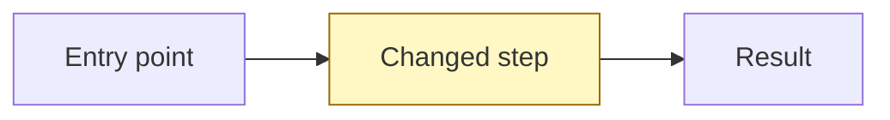

<!--
MR title format: [Task-ID] Short title
Example: [M1-08] Add playback to the virtual microphone

Write in English. Link the ticket, show the result, and let a reviewer repeat the check.
Delete any section that does not apply, except Task, Result and How to review.
-->

**Task:** [M1-08: Task title](https://gitlab.asoft-python.com/hau.dangduy/interlo/-/work_items/xxx)

## Goal

What this MR delivers and the user or business outcome, in two or three sentences.

## Description

What changed, one bullet per change. Name the files or modules where the change lives.

- Crate, module or file: what changed

## Implementation approach

How the work was done and why this approach was chosen over the alternatives. Mention any trade-off, shortcut or deliberate limit.

- Trade-off or limit: why

## What this MR does

Required. One Mermaid flow diagram: the entry point, the changed steps and the result. Built with the `mr-diagram` skill. New nodes are green and changed nodes yellow. An image is optional. Replace the placeholder below.

## Result

Artifact link and screenshots of the working result, in light and dark mode where the UI changed.

- Artifact: [Result artifact](https://xxx)
- Screenshots:

## How to review

Steps a reviewer can follow to confirm the result is correct. Each step has an expected outcome.

1. Check out the branch and run `scripts/check.sh full`.
2. Step: what to do, for a change a user sees (`npm --prefix apps/ui run dev`).
3. Expected: what the reviewer sees.

## Validation

Only list commands and checks that were run in this session, with the real result.

- `scripts/check.sh full` (paste the summary table):
- `scripts/check.sh e2e`, when the change touches a UI journey:
- Manual checks (light and dark mode, narrow and wide window):

## Irreversible After Merge

Keep this section ONLY when a revert will not restore the old state: migration, data change, public contract, anything already sent or published. Otherwise delete it.

**Stays after a revert:** what cannot be undone, and who or what it affects

**Recovery:** how to repair it, or none

## Checklist

- [ ] A test for each rule the change adds or changes
- [ ] `docs/guardrails.md` is not broken
- [ ] A change to a command or an event updates `docs/ipc-contract.md`, the Rust DTOs and `apps/ui/src/ipc/types.ts` together
- [ ] A fact in `docs/` that the change touched is updated
- [ ] No model, audio file or database is committed
- [ ] Every commit is signed off (DCO)

## Related

- Closes #<issue> (only when this MR fixes the exact issue; GitLab closes it on merge into the default branch)
- Depends on: !<merge request>
- Follow-up tickets:
