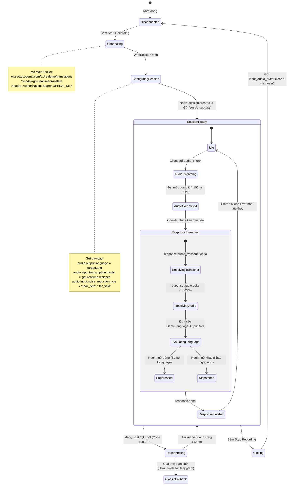
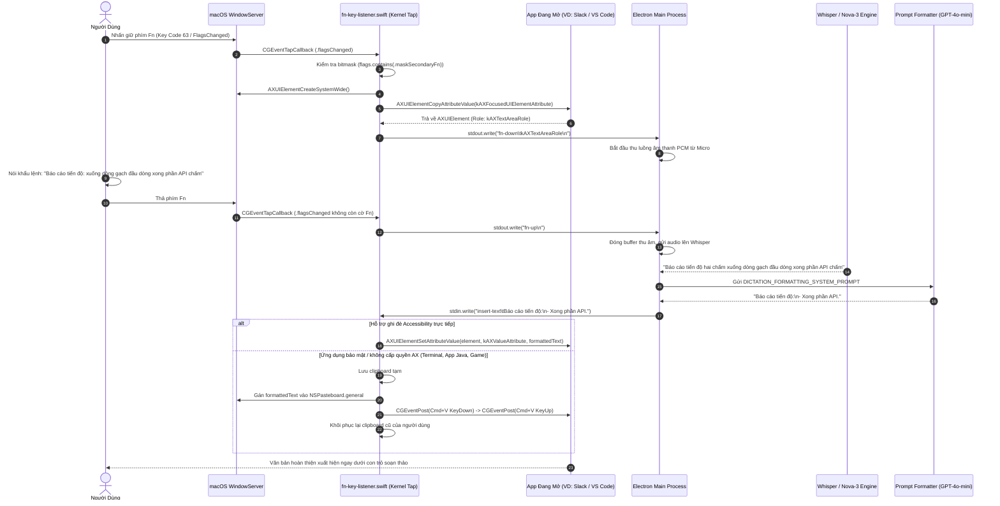
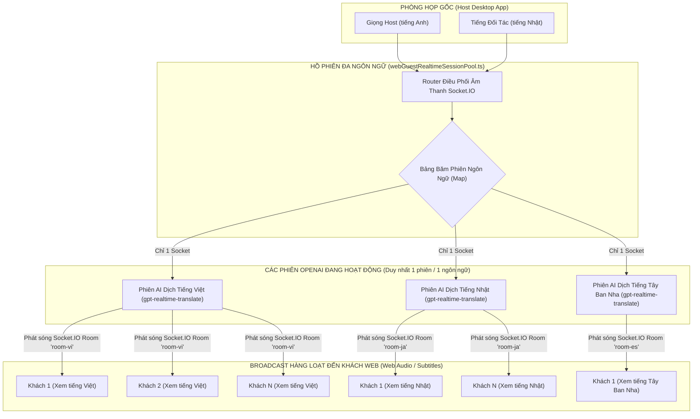
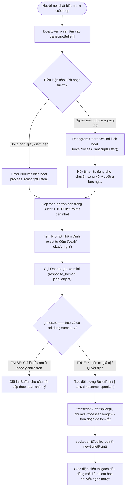
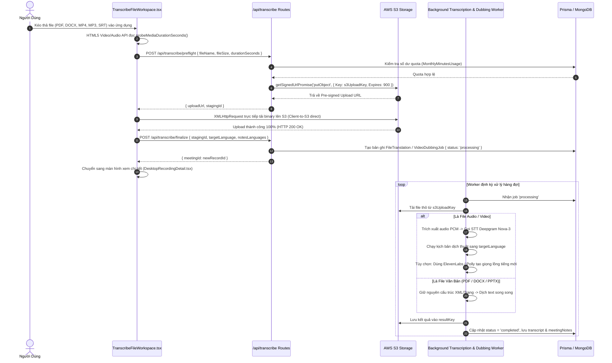
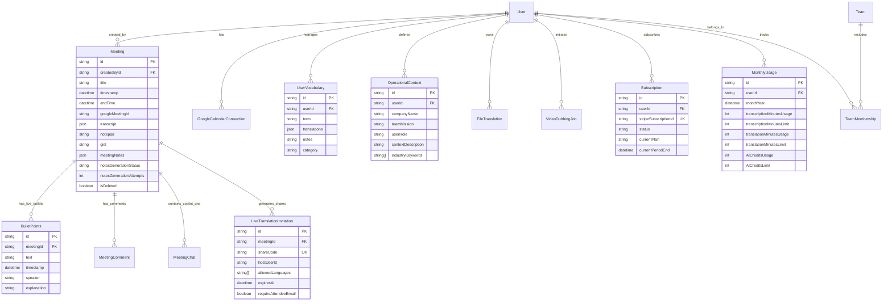

# Sơ Đồ Kiến Trúc Hệ Thống & Bóc Tách Chi Tiết Từng Tính Năng (Architecture Diagrams & Comprehensive Feature Breakdown)

- **Mã định danh dự án**: `LiveMeetingCopilot Core Engine` (Generic Sanitized Entity)
- **Phương pháp tiếp cận**: Reverse Engineering Assistant (REA) / REAP / Clean-Room Systems Architecture
- **Nguồn chứng cứ**: Bóc tách từ 1.680 file mã nguồn thực tế tại `data/live-meeting-copilot/raw/extracted/`.

---

## MỤC LỤC BẢN THIẾT KẾ & SƠ ĐỒ HỆ THỐNG
1. [Sơ Đồ 1: Cấu Trúc Đa Tầng Của Tiến Trình Desktop (Multi-Process Desktop Topology)](#1-sơ-đồ-1-cấu-trúc-đa-tầng-của-tiến-trình-desktop-multi-process-desktop-topology)
2. [Sơ Đồ 2: Chu Trình Xử Lý Âm Thanh Hai Luồng (Dual-Channel Audio Pipeline & Jitter Buffer)](#2-sơ-đồ-2-chu-trình-xử-lý-âm-thanh-hai-luồng-dual-channel-audio-pipeline--jitter-buffer)
3. [Sơ Đồ 3: Máy Trạng Thái Giao Thức OpenAI Realtime WebSocket (State Machine)](#3-sơ-đồ-3-máy-trạng-thái-giao-thức-openai-realtime-websocket-state-machine)
4. [Sơ Đồ 4: Kiến Trúc Phím Tắt Fn Toàn Hệ Thống (Native Swift EventTap & Accessibility)](#4-sơ-đồ-4-kiến-trúc-phím-tắt-fn-toàn-hệ-thống-native-swift-eventtap--accessibility)
5. [Sơ Đồ 5: Hồ Phiên Đa Ngôn Ngữ Tiết Kiệm 94% Chi Phí (Language-Pooled Web Relay)](#5-sơ-đồ-5-hồ-phiên-đa-ngôn-ngữ-tiết-kiệm-94-chi-phí-language-pooled-web-relay)
6. [Sơ Đồ 6: Vòng Đời Tóm Tắt Tức Thì 3 Giây (Live 3s Bullet Point Life Cycle)](#6-sơ-đồ-6-vòng-đời-tóm-tắt-tức-thì-3-giây-live-3s-bullet-point-life-cycle)
7. [Sơ Đồ 7: Pipeline Xử Lý File Kéo Thả 27 Định Dạng (Direct S3 Staging & Dubbing)](#7-sơ-đồ-7-pipeline-xử-lý-file-kéo-thả-27-định-dạng-direct-s3-staging--dubbing)
8. [Sơ Đồ 8: Sơ Đồ Thực Thể Cơ Sở Dữ Liệu Lõi (Prisma ERD Diagram)](#8-sơ-đồ-8-sơ-đồ-thực-thể-cơ-sở-dữ-liệu-lõi-prisma-erd-diagram)
9. [Bảng Đặc Tả Toàn Bộ Hợp Đồng Sự Kiện IPC & WebSocket (Event Contracts)](#9-bảng-đặc-tả-toàn-bộ-hợp-đồng-sự-kiện-ipc--websocket-event-contracts)

---

# 1. Sơ Đồ 1: Cấu Trúc Đa Tầng Của Tiến Trình Desktop (Multi-Process Desktop Topology)

Hệ thống desktop phân chia ranh giới nghiêm ngặt giữa **3 tiến trình con chạy độc lập**, giao tiếp bất đồng bộ:

```mermaid
graph TD
    subgraph KERNEL_SPACE["TẦNG HỆ ĐIỀU HÀNH & KERNEL (macOS / Windows)"]
        CORE_AUDIO["CoreAudio / WASAPI Audio Engine"]
        HAL_DRIVER["Virtual Audio HAL Driver (BlackHole / VB-CABLE)"]
        CG_SERVER["WindowServer & Accessibility Daemon (AXUIElement)"]
    end

    subgraph SWIFT_PROCESS["TIẾN TRÌNH NATIVE (Helper Child Process)"]
        SWIFT_DAEMON["fn-key-listener.swift Binary"]
        CG_TAP["CGEventTap (Lắng nghe .flagsChanged toàn cục)"]
        AX_PROBER["AXUIElement Prober (Tìm focused input element)"]
        PASTE_OBSERVER["PasteAccessibilityObservation (Giả lập Cmd+V / Set AXValue)"]
    end

    subgraph ELECTRON_MAIN["TIẾN TRÌNH ELECTRON MAIN (Node.js Background Process)"]
        APP_ENTRY["background.ts (Entry Point & Lifecycle)"]
        WIN_CONTROLLER["Window Bounds Controller (Persist Home vs Recording bounds)"]
        LOCAL_AUTH_SRV["Local Auth HTTP Server (Port 8000 for OAuth callback)"]
        LEARNING_GUARD["Learning Guard (osascript browser tab prober)"]
        PRELOAD_API["preload.ts (ContextBridge Sandbox API)"]
    end

    subgraph RENDERER["TIẾN TRÌNH RENDERER (Chromium Webview - Next.js)"]
        UI_STORE["Redux Toolkit Store (Recorder, Sharing, Languages)"]
        CONTROLLER_HUD["Controllers.tsx (Floating Pill Overlay HUD)"]
        TRANSCRIPT_LIST["Transcript.tsx (Bilingual Virtualized Dialogue Stream)"]
        NOTION_NOTE["NotionEditor.tsx (Tiptap / Lexical Rich Editor)"]
        AUDIO_WORKLET["AudioWorklet / ScriptProcessor (16kHz PCM Streamer)"]
        PCM_QUEUE["PcmPlaybackQueue.ts (Jitter Buffer & AudioContext Sink)"]
    end

    subgraph BACKEND_SRV["TIẾN TRÌNH SERVER NỘI BỘ (Express + Socket.IO Port 5001)"]
        SOCKET_IO["Socket.IO Server (/socket.io)"]
        FAST_PIPELINE["FastRealtimePipeline (OpenAI WebSocket Client)"]
        CLASSIC_PIPELINE["ClassicPipeline (Deepgram Nova-3 STT + TTS)"]
        GATE_KEEPER["SameLanguageOutputGate (Sliding 500ms Suppress Filter)"]
        NOTES_WORKER["PostMeetingNotes Worker (MongoDB queue lock)"]
    end

    CORE_AUDIO <-->|Hardware I/O| HAL_DRIVER
    CG_SERVER <-->|Event Tap| CG_TAP
    CG_SERVER <-->|Attribute Queries| AX_PROBER

    CG_TAP --> SWIFT_DAEMON
    AX_PROBER --> SWIFT_DAEMON
    SWIFT_DAEMON -->|stdout: 'fn-down\trole'| APP_ENTRY
    APP_ENTRY -->|stdin: 'insert-text\tcontent'| SWIFT_DAEMON
    SWIFT_DAEMON --> PASTE_OBSERVER
    PASTE_OBSERVER --> CG_SERVER

    APP_ENTRY <-->|IPC Invoke / Send| PRELOAD_API
    PRELOAD_API <-->|contextBridge.exposeInMainWorld| RENDERER

    AUDIO_WORKLET -->|socket.emit('audio_chunk')| SOCKET_IO
    SOCKET_IO --> FAST_PIPELINE
    SOCKET_IO --> CLASSIC_PIPELINE
    FAST_PIPELINE --> GATE_KEEPER
    GATE_KEEPER -->|socket.emit('realtime_audio_delta')| PCM_QUEUE
    PCM_QUEUE -->|WebAudio API setSinkId| CORE_AUDIO
    HAL_DRIVER -->|System Audio Feed| AUDIO_WORKLET
```

---

# 2. Sơ Đồ 2: Chu Trình Xử Lý Âm Thanh Hai Luồng (Dual-Channel Audio Pipeline & Jitter Buffer)

Hệ thống bắt đồng thời 2 luồng âm thanh và xử lý lọc nhiễu, chuyển tần số, chống vọng âm trước khi chuyển tiếp cho AI:

```mermaid
flowchart LR
    subgraph INGESTION["1. THU ÂM & CHUYỂN TẦN SỐ MẪU (Sample Rate Adaptation)"]
        MIC_IN["Microphone Vật Lý (44.1k / 48kHz Float32)"] --> DOWNSAMPLE_MIC["StreamingPcmDownsampler (Continuous Box Filter)"]
        SYS_IN["Họp Zoom/Meet (BlackHole 48kHz Float32)"] --> DOWNSAMPLE_SYS["StreamingPcmDownsampler (Continuous Box Filter)"]
        DOWNSAMPLE_MIC -->|16kHz 16-bit PCM Mono| MERGE_GATE["Dual-Stream TTS Capture Suppression Gate"]
        DOWNSAMPLE_SYS -->|16kHz 16-bit PCM Mono| MERGE_GATE
    end

    subgraph ANTI_ECHO["2. LỌC TIẾNG VỌNG & KHỬ ÂM HỒI (Anti-Feedback Guard)"]
        TTS_STATUS{"Giọng đọc dịch AI đang phát?"}
        MERGE_GATE --> TTS_STATUS
        TTS_STATUS -->|ĐANG PHÁT| SUPPRESS_CHUNK["Thay thế bằng Silence Buffer (Ngăn Micro tự thu tiếng dịch)"]
        TTS_STATUS -->|KHÔNG PHÁT| PASS_CHUNK["Giữ nguyên Buffer âm thanh nguyên bản"]
    end

    subgraph RESAMPLER["3. NỘI SUY TUYẾN TÍNH (16k -> 24k)"]
        PASS_CHUNK --> LINEAR_MATH["pcmResampler.ts (Linear Interpolation ratio 1.5)"]
        LINEAR_MATH --> CLAMP["Clamp Int16 Bounds [-32768, 32767]"]
        CLAMP --> CHUNKER["100ms - 200ms Frame Commit (Min 4,800 bytes)"]
    end

    subgraph REALTIME_SOCKET["4. OPENAI REALTIME PROTOCOL"]
        CHUNKER --> WS_APPEND["input_audio_buffer.append (Base64 PCM24)"]
        WS_APPEND --> WS_COMMIT["input_audio_buffer.commit"]
    end

    subgraph JITTER_BUFFER["5. PHÁT ÂM THANH MƯỢT (PcmPlaybackQueue Jitter Buffer)"]
        S2S_OUT["response.audio.delta (Base64 PCM24 từ AI)"] --> HOLD_GATE["SameLanguageOutputGate (Giữ 500ms)"]
        HOLD_GATE -->|Phê duyệt phát| QUEUE["PcmPlaybackQueue (Underrun Grace 4ms, Tail 150ms)"]
        QUEUE --> DECODE["AudioContext.createBuffer(1, samples, 24000)"]
        DECODE --> PLAY["AudioBufferSourceNode.start(nextStartTime)"]
        PLAY --> SINK["Output Sink: Tai nghe (Incoming) HOẶC Micro ảo (Outgoing)"]
    end

    REALTIME_SOCKET --> S2S_OUT
```



---

# 3. Sơ Đồ 3: Máy Trạng Thái Giao Thức OpenAI Realtime WebSocket (State Machine)

Toàn bộ phiên làm việc Realtime S2S được điều khiển bởi máy trạng thái phức hợp xử lý kết nối, bắt tay, streaming và giải phóng:



---

# 4. Sơ Đồ 4: Kiến Trúc Phím Tắt Fn Toàn Hệ Thống (Native Swift EventTap & Accessibility)

Tính năng Voice Keyboard biến bất kỳ ô văn bản nào trên macOS thành giao diện nhận diện giọng nói mà không cần mở app:



---

# 5. Sơ Đồ 5: Hồ Phiên Đa Ngôn Ngữ Tiết Kiệm 94% Chi Phí (Language-Pooled Web Relay)

Bản vẽ giải thích thuật toán gom nhóm phiên theo ngôn ngữ đích giúp máy chủ chịu tải hàng trăm khách dự họp:



---

# 6. Sơ Đồ 6: Vòng Đời Tóm Tắt Tức Thì 3 Giây (Live 3s Bullet Point Life Cycle)



---

# 7. Sơ Đồ 7: Pipeline Xử Lý File Kéo Thả 27 Định Dạng (Direct S3 Staging & Dubbing)



---

# 8. Sơ Đồ 8: Sơ Đồ Thực Thể Cơ Sở Dữ Liệu Lõi (Prisma ERD Diagram)

Mô hình dữ liệu quan hệ trích xuất từ `server/prisma/schema.prisma` (98 KB):



---

# 9. Bảng Đặc Tả Toàn Bộ Hợp Đồng Sự Kiện IPC & WebSocket (Event Contracts)

### 9.1. Giao Tiếp Electron IPC (`main` $\longleftrightarrow$ `renderer`)

| Kênh IPC | Chiều | Kiểu Dữ Liệu | Mục Đích Kỹ Thuật |
| :--- | :--- | :--- | :--- |
| `getAudioRoutingCapabilities` | Renderer $\to$ Main | `invoke()` $\to$ `AudioRoutingCaps` | Lấy danh sách driver ảo cài đặt trên máy (`BlackHole`, `VB-CABLE`). |
| `openBundledBlackHoleInstaller`| Renderer $\to$ Main | `invoke(channelCount: '2ch'|'16ch')` | Mở trình cài đặt package `.pkg` của driver BlackHole đóng gói sẵn. |
| `window-view-mode` | Renderer $\to$ Main | `send(mode: 'main'|'recording')` | Báo Main process hoán đổi kích thước cửa sổ giữa Dashboard và HUD nổi. |
| `set-always-on-top` | Renderer $\to$ Main | `send(flag: boolean)` | Bật chế độ ghim cửa sổ nổi luôn ở trên cùng màn hình khi họp. |
| `fn-key-status` | Main $\to$ Renderer | `send(status: 'down'|'up')` | Thông báo phím Fn vừa được nhấn giữ hoặc thả ra để bật/tắt ghi âm dictation. |
| `learning-state` | Main $\to$ Renderer | `send(state: LearningState)` | Cập nhật tiến độ giải đố ngoại ngữ và trạng thái chặn mạng xã hội. |
| `dock-file-opened` | Main $\to$ Renderer | `send({ filePath, token })` | Bắn sự kiện khi người dùng kéo thả file tài liệu/video vào icon ứng dụng trên Dock. |

### 9.2. Giao Tiếp Socket.IO (`renderer` $\longleftrightarrow$ `server`)

| Tên Sự Kiện Socket | Chiều | Cấu Trúc Dữ Liệu | Mô Tả Nghiệp Vụ |
| :--- | :--- | :--- | :--- |
| `start_recording` | Client $\to$ Server | `{ meetingId, spokenLanguage, targetLanguage, translationMode, speechToSpeechMode }` | Khởi động phiên ghi âm và cấp phát luồng AI. |
| `audio_chunk` | Client $\to$ Server | `Binary Buffer (Int16 PCM 16kHz)` | Truyền các khối âm thanh nén thời gian thực lên server. |
| `pipeline_mode` | Server $\to$ Client | `{ mode: 'realtime-fast'|'classic', model }` | Báo cho Client biết đang chạy OpenAI WebSocket hay Deepgram. |
| `realtime_transcript_delta` | Server $\to$ Client | `{ delta, isFinal, speaker, desktopAudioSource, sectionId }` | Đẩy từng từ phiên âm và dịch thuật xuống hiển thị dòng chữ nhảy mượt. |
| `realtime_audio_delta` | Server $\to$ Client | `{ pcmBase64, sequence, elapsedMs }` | Đẩy từng gói âm thanh dịch S2S xuống cho hàng đợi `PcmPlaybackQueue`. |
| `bullet_point` | Server $\to$ Client | `{ text, timestamp, speaker }` | Đẩy gạch đầu dòng ý chính tự động sinh sau mỗi 3 giây hoặc dứt câu. |
| `meeting_notes_ready` | Server $\to$ Client | `{ gist, actionItems, keyPoints, otherPoints }` | Thông báo biên bản cuộc họp hoàn chỉnh sau phiên đã sinh xong. |
