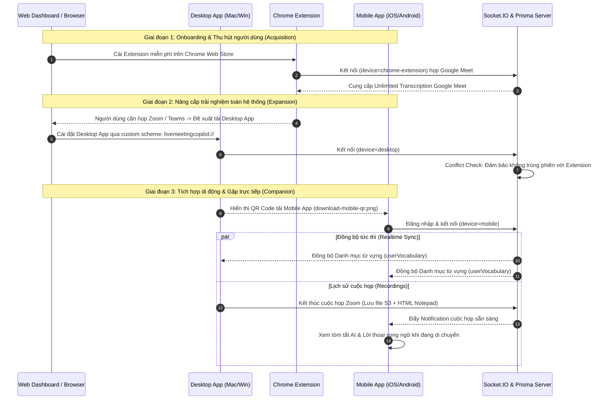

# LiveMeetingCopilot - Báo Cáo Phân Tích Hệ Sinh Thái Đa Nền Tảng
## So Sánh Chi Tiết Kiến Trúc: Desktop App vs Chrome Extension vs Mobile App

- **Mã chứng cứ REAP**: `ev_9b1b8eb3fba474431183977add65334a4d841644f78c6f404e6c30a39e70e766`
- **Phạm vi phân tích**: Bóc tách toàn diện 3 bề mặt người dùng (Surfaces): **Desktop App** (Electron/Swift/Win32), **Chrome Extension** (Manifest V3), và **Mobile App** (iOS/Android).
- **Quy chuẩn danh xưng**: Tuân thủ tuyệt đối quy tắc khử thương hiệu bên thứ ba (`NO OTHER PRODUCTS BY NAME`), sử dụng định danh trung tính **LiveMeetingCopilot**.

---

## 1. MA TRẬN SO SÁNH TỔNG QUAN (CROSS-PLATFORM MATRIX)

| Tiêu Chí Kỹ Thuật | Desktop App (`device=desktop`) | Chrome Extension (`device=chrome-extension`) | Mobile App (`device=mobile`) |
| :--- | :--- | :--- | :--- |
| **Nền tảng mục tiêu** | macOS (ARM64/Intel), Windows (x64) | Google Chrome, Chromium (Brave, Edge) | iOS (App Store), Android (Google Play) |
| **Công nghệ cốt lõi** | Electron + React 19 + Swift + Win32 C# P/Invoke | Manifest V3 + Content Script + Web Audio | React Native / Mobile Native + Socket.IO |
| **Phạm vi ứng dụng họp** | **Toàn hệ thống**: Zoom, Teams, Meet, Slack, Offline Audio | **Duy nhất trong tab**: Google Meet in-browser | **Gặp mặt trực tiếp (In-person)**, Voice Memo |
| **Cơ chế bắt âm thanh** | Driver ảo (BlackHole / VB-CABLE) + Loopback không dialog | `chrome.tabCapture` / DOM Closed Captions | Hardware Microphone (Built-in mic) |
| **Phiên dịch giọng nói 2 chiều** | Có (`online-both`) qua phân lập 2 kênh Bus ảo riêng biệt | Không (Chỉ dịch hiển thị text 1 chiều trên trang) | Có (`in-person` mode) phát trực tiếp ra loa ngoài |
| **Voice Dictation hệ thống** | Có (Nhấn giữ phím Fn / Ctrl+Win gõ vào mọi app) | Không (Chỉ hoạt động trong giao diện extension) | Có (Speech-to-text cho ghi chú di động) |
| **Tự động hóa OS / Trình duyệt** | JXA / Win32 UIA giám sát URL, đóng tab MXH (Learning Guard) | Không can thiệp ra ngoài phạm vi tab Google Meet | Không can thiệp ứng dụng khác của OS |
| **Định dạng sổ ghi chú (Notepad)**| HTML TipTap / Notion-like Block Editor | Plain Markdown (`notepadFormat: 'markdown'`) | Rich-text di động / Đồng bộ đám mây |
| **Trình phát WaveSurfer** | WaveSurfer đa phân đoạn, song ngữ 2 cột, sửa inline | Trình phát web đơn giản | Trình phát audio native đồng bộ text |
| **Chính sách giá & Hạn ngạch** | Giới hạn theo phút (Pro: 500 phút, Fast S2S: 200 phút) | **Unlimited Free Transcription** trên Google Meet | Dùng chung hạn ngạch tài khoản qua DB |
| **Xung đột phiên (Conflict)** | Chặn nếu đã có 1 phiên desktop đang ghi âm | Chặn nếu chạy song song với Desktop | Tự động đồng bộ trạng thái qua Socket.IO |

---

## 2. BÓC TÁCH CHI TIẾT TỪNG NỀN TẢNG

```mermaid
flowchart TD
    subgraph Multi_Platform["Hệ Sinh Thái 3 Nền Tảng (LiveMeetingCopilot)"]
        DESKTOP["1. Desktop App (Electron / Swift / C#)\n• Mọi phần mềm họp (Zoom, Teams, Meet)\n• Loopback Audio Driver (BlackHole/VB-CABLE)\n• Phím Fn Dictation toàn OS\n• Learning Guard đóng tab sao nhãng"]
        EXTENSION["2. Chrome Extension (Manifest V3)\n• Chuyên biệt cho Google Meet\n• Unlimited Transcription\n• Nhẹ, không cần cài Driver\n• Tab Audio / DOM Captions"]
        MOBILE["3. Mobile App (iOS / Android)\n• Chuyên biệt In-Person (Mặt đối mặt)\n• Không cần Driver ảo (Phát loa ngoài)\n• Tra cứu ghi chú, nghe lại file ghi âm\n• Ôn tập từ vựng Flashcard"]
    end

    subgraph Central_Backend["Hạ Tầng Backend Trung Tâm (Socket.IO Gateway)"]
        AUTH_ROUTER["ConnectionService.ts\nuserSocketMap[userId][device]"]
        CONFLICT_MGR["MeetingHelpers.findPendingMeeting\n(Conflict Check & Blocking)"]
        S2S_ENGINE["OpenAI Realtime / Deepgram Nova-3\n(Unified AI Pipeline)"]
        PRISMA_DB[(PostgreSQL / Prisma DB\nUsers, Meetings, Usage, Vocab)]
    end

    DESKTOP <-->|Socket.IO (device=desktop)| AUTH_ROUTER
    EXTENSION <-->|Socket.IO (device=chrome-extension)| AUTH_ROUTER
    MOBILE <-->|Socket.IO (device=mobile)| AUTH_ROUTER

    AUTH_ROUTER --> CONFLICT_MGR
    AUTH_ROUTER --> S2S_ENGINE
    CONFLICT_MGR <--> PRISMA_DB
    S2S_ENGINE <--> PRISMA_DB
```

---

## 3. NỀN TẢNG 1: DESKTOP APP (THE POWERHOUSE)

Desktop App là sản phẩm chủ lực và phức tạp nhất trong toàn bộ hệ sinh thái:

### 3.1. Điểm mạnh công nghệ
1. **Âm thanh độc quyền không hộp thoại**: Hook vào `ses.setDisplayMediaRequestHandler` với `audio: "loopback", video: null`, bắt trọn âm thanh loa máy tính mà không xuất hiện bất kỳ cửa sổ pop-up chia sẻ màn hình nào.
2. **Kỹ thuật phiên dịch giọng nói 2 chiều hoàn toàn tự động**: Phân tách 2 bus ảo độc lập:
   - Thu âm cuộc họp: `BlackHole 2ch` (macOS) hoặc `VB-CABLE-A` (Windows).
   - Phát giọng dịch vào micro cuộc họp: `BlackHole 16ch` (macOS) hoặc `VB-CABLE` (Windows).
   - Ngăn chặn triệt để hiện tượng phản hồi âm vô tận (Acoustic Feedback Loop).
3. **Voice Keyboard (Fn Key Dictation)**:
   - macOS: Dùng file Swift biên dịch tĩnh `fn-key-listener.swift` bắt sự kiện `kCGEventFlagsChanged` cờ `0x800000`.
   - Windows: Dùng P/Invoke `user32.dll` `GetAsyncKeyState` bắt `Ctrl + Win`.
   - Tự động nhận diện ứng dụng đang mở (Slack, VS Code, Notion), đọc chiều dài văn bản trước và sau khi dán phím ảo để xác thực, và tuyệt đối từ chối dán vào ô mật khẩu (`isSecureTextRole`).
4. **Learning Guard (Chống sao nhãng)**:
   - Giám sát URL trình duyệt qua JXA (`osascript -l JavaScript`) trên macOS và UIAutomation trên Windows.
   - Khi người dùng lướt TikTok/YouTube/Reddit quá thời gian cho phép, app tự động gửi lệnh đóng tab và mở cửa sổ toàn màn hình `#101024` hiển thị bài trắc nghiệm từ vựng tiếng nước ngoài trích xuất từ chính cuộc họp trước.

---

## 4. NỀN TẢNG 2: CHROME EXTENSION (THE ACQUISITION FUNNEL)

Dựa trên mã nguồn `server/src/modules/meeting/meeting.helpers.ts` và `recordings.service.ts`:

### 4.1. Vai trò chiến lược
- **Phễu chuyển đổi người dùng miễn phí (Free Viral Loop)**: Gói Pro quy định: *"Unlimited transcription for Chrome extension on Google Meet"*.
- Người dùng chỉ cần cài extension vào Chrome, không cần quyền Quản trị viên (Admin), không cần cài đặt driver âm thanh phức tạp.
- Khi người dùng muốn dùng trên Zoom/Teams hoặc muốn phiên dịch giọng nói 2 chiều, app sẽ hiển thị lời mời nâng cấp và chuyển hướng sang tải Desktop App.

### 4.2. Kiến trúc kỹ thuật của Extension
1. **Định danh phiên họp**:
   - `sessionSource`: Đánh dấu là `'chrome-extension'`.
   - `isDesktop`: Mang giá trị `false` hoặc `null`.
   - `googleMeetingId`: Khóa chặt với mã phòng Google Meet (ví dụ: `abc-defg-hij`).
2. **Cơ chế thu âm & dữ liệu**:
   - Chạy trực tiếp trong tab Google Meet qua `chrome.tabCapture` stream âm thanh về WebSocket server.
   - Bóc tách phụ đề thời gian thực (Closed Captions) từ cấu trúc thẻ DOM của Google Meet để tăng độ chính xác của tên người nói (Speaker Diarization).
3. **Định dạng ghi chú**:
   - Khác với Desktop dùng HTML Block Editor, Extension xuất ghi chú dưới dạng Markdown thuần (`notepadFormat: 'markdown'`) để đồng bộ nhẹ nhàng trong khung chat hẹp của extension.
4. **Quy tắc giải quyết xung đột (Conflict Rule)**:
   - Trong `meeting.helpers.ts` (dòng 1405-1409): Nếu một người dùng đang mở ghi âm trên Chrome Extension mà cố tình bấm Start trên Desktop App, server sẽ lập tức chặn phiên Desktop và phát mã lỗi:
     `{ blocked: true, reason: 'chrome_extension', meetingId: pendingChromeExtension.id }`.

---

## 5. NỀN TẢNG 3: MOBILE APP (THE COMPANION & IN-PERSON TRANSLATOR)

Dựa trên các tham số cấu hình trong `renderer/utils/audioRoutingAutoConfig.ts`, `server/src/services/ConnectionService.ts` và asset `live-meeting-mobile-download-qr.png`:

### 5.1. Vai trò nghiệp vụ
Mobile App được thiết kế nhằm giải quyết 3 tình huống mà Laptop không thể đáp ứng:
1. **Chế độ họp trực tiếp mặt đối mặt (`in-person` mode)**: Hai người ngồi cà phê hoặc bàn họp nói chuyện trực tiếp.
2. **Nghe lại và tìm kiếm ghi chú di động**: Tra cứu nhanh nội dung tóm tắt, action items khi đang di chuyển trên đường.
3. **Ôn tập từ vựng di động (Mobile Vocabulary Flashcards)**: Học lại các thuật ngữ vừa xuất hiện trong cuộc họp ban sáng.

### 5.2. Kiến trúc âm thanh chế độ `in-person`
Trong `audioRoutingAutoConfig.ts` (dòng 605-637):
```typescript
if (mode === 'in-person') {
    const config = {
        meetingCapture: 'loopback',
        outgoing: 'default', // Loa ngoài vật lý của điện thoại
        incoming: '',
        ttsOwnVoice: false,
        meetingCaptureBus: null, // Không cần driver ảo
        outgoingBus: null,
        incomingIsPhysical: false,
    };
    applyAudioRoutingConfig(config, isRecording);
}
```
- **Không cần Driver ảo**: Điện thoại sử dụng micro vật lý để thu âm cả hai người, và dùng loa ngoài vật lý (`outgoing: 'default'`) để phát to câu dịch cho đối phương nghe.
- **Microphone Switching**: Tự động nhận diện tai nghe Bluetooth (AirPods/Galaxy Buds) để chuyển mic mà không làm ngắt phiên dịch.

### 5.3. Kết nối & Đồng bộ trạng thái (`ConnectionService.ts`)
- Mobile App kết nối vào cùng một cụm máy chủ Socket.IO với tham số handshake:
  `ws://server/socket.io/?userId=...&device=mobile`
- Server lưu phiên vào bản đồ socket phân tán:
  `userSocketMap[userId]['mobile'] = socketId`
- Khi người dùng đang họp trên máy tính, họ có thể dùng điện thoại quét mã QR chia sẻ (`ShareMeeting.tsx`) để biến điện thoại thành **Màn hình phụ hiển thị lời dịch song ngữ thời gian thực (Real-time Live Subtitle Display)** đặt trên bàn làm việc.

---

## 6. SƠ ĐỒ LUỒNG PHỐI HỢP ĐỒNG BỘ 3 NỀN TẢNG (INTEROPERABILITY FLOW)



---

## 7. KẾT LUẬN & KIẾN TẠO KỸ THUẬT CHO CLEAN-ROOM CLONE

Qua việc bóc tách toàn diện 3 bề mặt (`Desktop`, `Chrome Extension`, `Mobile`), chúng ta rút ra bài học kiến trúc đắt giá:
1. **Kiến trúc phân tầng bề mặt thông minh (Surface-Driven Strategy)**:
   - Chrome Extension đóng vai trò là "mũi khoan" thâm nhập thị trường với rào cản cài đặt bằng 0 và chính sách miễn phí không giới hạn trên Google Meet.
   - Desktop App là cỗ máy tạo doanh thu (Monetization Engine) với các tính năng can thiệp sâu vào hệ điều hành (Virtual Audio 2 chiều, Fn Dictation, Learning Guard).
   - Mobile App là mắt xích hoàn thiện vòng đời trải nghiệm (Retention Loop) hỗ trợ dịch trực tiếp ngoài đời thực và ôn tập kiến thức mọi lúc mọi nơi.
2. **Thiết kế Backend thống nhất**:
   - Dù là nền tảng nào (`desktop`, `chrome-extension`, hay `mobile`), toàn bộ đều kết nối về một WebSocket Gateway duy nhất, chia sẻ chung cơ chế phân bổ từ vựng, hạn ngạch thanh toán và đường ống AI Realtime Speech-to-Speech.
