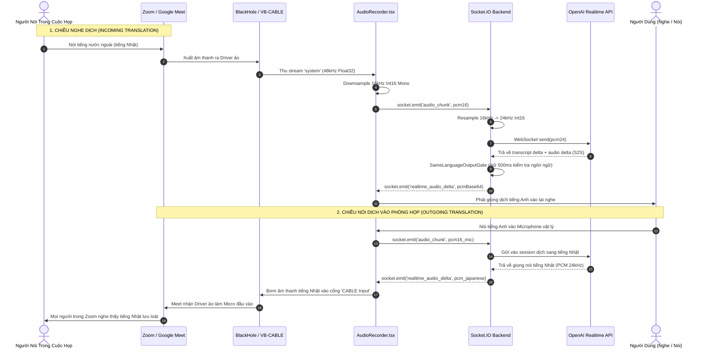
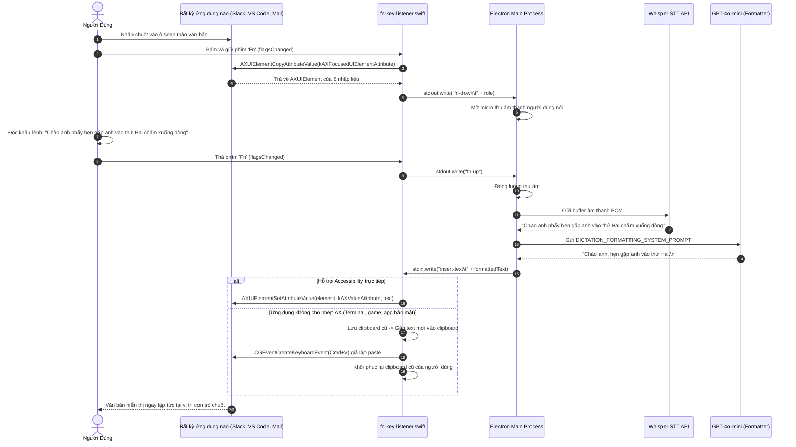
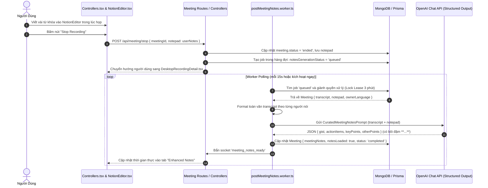
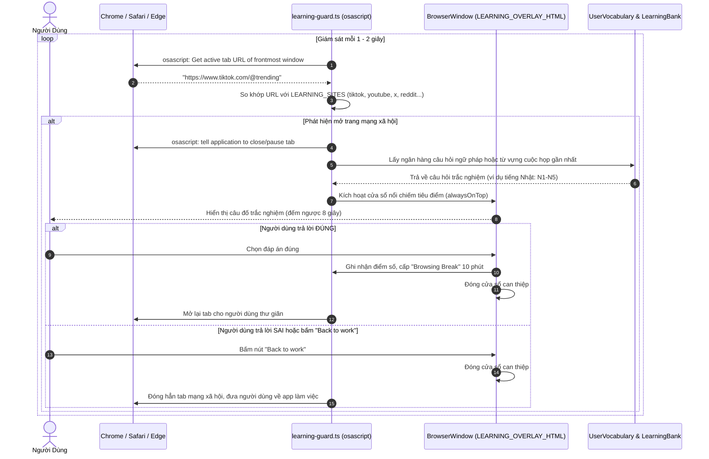

# Bóc Tách Toàn Diện: Tính Năng, Thuật Toán, Kiến Trúc & Luồng Dữ Liệu Chi Tiết (Master Deconstruction Manual)

- **Định danh mục tiêu**: `LiveMeetingCopilot Desktop & Cloud Ecosystem` (Generic Sanitized Entity)
- **Phương pháp luận**: REA (Reverse Engineering Assistant) & REAP (Investigation Prompts)
- **Cơ sở phân tích**: Toàn bộ mã nguồn Main Process, Renderer UI, Backend Microservices, Native Swift Driver và Prisma Schema trích xuất tại `data/live-meeting-copilot/raw/extracted/`.

---

## MỤC LỤC CHI TIẾT
1. [Bản Đồ Kiến Trúc Tổng Thể (System Architecture Map)](#1-bản-đồ-kiến-trúc-tổng-thể-system-architecture-map)
2. [Bóc Tách Toàn Bộ 8 Cụm Tính Năng Lõi](#2-bóc-tách-toàn-bộ-8-cụm-tính-năng-lõi)
   - 2.1. Cụm Giao Diện Nổi & Điều Khiển Cuộc Họp (Floating Overlay & HUD)
   - 2.2. Cụm Thu Âm & Bơm Âm Thanh Đa Luồng (Audio Loopback & Injection Engine)
   - 2.3. Cụm Pipeline Dịch Giọng Nói Hai Chiều Thời Gian Thực (Dual-Engine S2S & STT)
   - 2.4. Cụm Trí Tuệ Cuộc Họp Trực Tiếp (In-Meeting Copilot & Live 3s Bullet Points)
   - 2.5. Cụm Biên Bản Cuộc Họp Sau Phiên & Trình Biên Soạn Tinh Chỉnh (Post-Meeting Curation & Notion Editor)
   - 2.6. Cụm Gõ Bằng Giọng Nói Toàn Hệ Điều Hành (System-Wide Fn Voice Keyboard)
   - 2.7. Cụm CRM Trí Tuệ Cuộc Họp (People & Company Intelligence CRM)
   - 2.8. Cụm Focus Guard & Micro-Learning Chặn Mạng Xã Hội (Distraction Interceptor)
3. [Phân Tích Chuyên Sâu Các Thuật Toán Trọng Tâm](#3-phân-tích-chuyên-sâu-các-thuật-toán-trọng-tâm)
   - 3.1. Thuật toán Ghép Dòng Phụ Đề Không Giật Nháy (`findTargetIndex`)
   - 3.2. Thuật toán Nội Suy Tuyến Tính Chuyển Tần Số Âm Thanh (16kHz -> 24kHz Linear Resampler)
   - 3.3. Thuật toán Cổng Chặn Lặp Ngôn Ngữ Trễ 500ms (`SameLanguageOutputGate`)
   - 3.4. Thuật toán Hồ Phiên Đa Ngôn Ngữ Chia Sẻ Web (`webGuestRealtimeSessionPool`)
   - 3.5. Thuật toán Đánh Giá Sinh Ý Chính Tức Thì (VAD Trigger & Dual-Timer Loop)
   - 3.6. Thuật toán Khóa Snapshot Tính Phí & Hệ Số Nhân Dịch Thuật
4. [Sơ Đồ Tuần Tự (Sequence Diagrams) Các Luồng Trọng Yếu](#4-sơ-đồ-tuần-tự-sequence-diagrams-các-luồng-trọng-yếu)
   - 4.1. Luồng Thu Âm, Dịch S2S và Bơm Micro Ảo vào Zoom/Teams
   - 4.2. Luồng Bấm Giữ Phím Fn Gõ Văn Bản Xuyên Ứng Dụng
   - 4.3. Luồng Tạo và Biên Soạn Biên Bản Cuộc Họp Thông Minh
   - 4.4. Luồng Can Thiệp Tab Trình Duyệt Chặn Xao Nhãng

---

# 1. Bản Đồ Kiến Trúc Tổng Thể (System Architecture Map)

Hệ thống được thiết kế theo mô hình **Hybrid Desktop-Cloud Split Runtime**:

```mermaid
flowchart TD
    subgraph OS_LAYER["1. TẦNG HỆ ĐIỀU HÀNH & PHẦN CỨNG (macOS / Windows)"]
        HW_MIC["Microphone Vật Lý (Hardware Mic)"]
        CONF_APP["Ứng dụng họp (Zoom / Teams / Google Meet)"]
        VIRTUAL_DRIVER["Driver Âm Thanh Ảo (BlackHole HAL / VB-CABLE)"]
        CG_EVENT["Native Event Tap (CGEventTap / Windows Hook)"]
        AX_ENGINE["Hệ thống Accessibility OS (AXUIElement)"]
    end

    subgraph ELECTRON_MAIN["2. TIẾN TRÌNH ELECTRON MAIN (Node.js + Swift Native)"]
        SWIFT_HELPER["fn-key-listener.swift (Bắt phím Fn & focus input)"]
        WIN_MGR["Window Bounds Transition Manager (Persist tọa độ & ViewMode)"]
        TRAY_MGR["System Tray & Calendar Sync Helper"]
        GUARD_MGR["Learning Guard (osascript giám sát tab mạng xã hội)"]
        PRELOAD_BRIDGE["Preload ContextBridge (IPC API Type-Safe)"]
    end

    subgraph RENDERER_UI["3. TIẾN TRÌNH RENDERER (Next.js + React 19 + Redux)"]
        HUD_CONTROLLER["Controllers.tsx (Thanh điều khiển nổi Floating Pill)"]
        AUDIO_WORKLET["StreamingPcmDownsampler (48kHz Float32 -> 16kHz Int16 Mono)"]
        TRANSCRIPT_VIEW["Transcript.tsx (Bilingual Live Virtualized Stream)"]
        NOTION_EDITOR["NotionEditor.tsx (Tiptap / Lexical Rich Markdown Editor)"]
        DETAIL_VIEW["DesktopRecordingDetail.tsx (WaveSurfer.js + Multi-tab)"]
        LATENCY_HUD["TranslationLatencyMonitor.tsx (Đo trễ realtime ms)"]
    end

    subgraph BACKEND_SERVER["4. TIẾN TRÌNH BACKEND (Node.js + Express + Socket.IO Port 5001)"]
        SOCKET_ROUTER["Realtime Audio Router (audio.handler.ts)"]
        PCM_RESAMPLER["Linear PCM Resampler (16kHz -> 24kHz)"]
        OUTPUT_GATE["SameLanguageOutputGate (Sliding 500ms Delay & Suppress)"]
        GUEST_POOL["WebGuestRealtimeSessionPool (Gộp phiên theo ngôn ngữ)"]
        BULLET_SERVICE["BulletPointService (3s Loop + Deepgram UtteranceEnd VAD)"]
        SUMMARIZE_SERVICE["SummarisationService (OpenAI Structured Output Gist/Notes)"]
        NOTE_WORKER["PostMeetingNotes Worker (MongoDB queue lock lease)"]
    end

    subgraph CLOUD_APIS["5. DỊCH VỤ ĐÁM MÂY & AI PROVIDERS"]
        OPENAI_REALTIME["OpenAI Realtime API (WebSocket S2S: gpt-realtime-translate)"]
        DEEPGRAM_STT["Deepgram Nova-3 API (Streaming STT & VAD)"]
        OPENAI_LLM["OpenAI GPT-4o-mini (Tóm tắt, Bullet Points, Format văn bản)"]
        TTS_CLOUD["ElevenLabs / Deepgram Aura / Azure Speech (TTS Synthesis)"]
        S3_STORAGE["AWS S3 Bucket (Lưu trữ file âm thanh & dubbing)"]
        MONGO_DB["MongoDB Cluster + Prisma ORM (Cơ sở dữ liệu)"]
    end

    HW_MIC -->|WebAudio 48kHz| AUDIO_WORKLET
    CONF_APP -->|Loa ra driver ảo| VIRTUAL_DRIVER
    VIRTUAL_DRIVER -->|System Loopback 48kHz| AUDIO_WORKLET
    CG_EVENT --> SWIFT_HELPER
    SWIFT_HELPER -->|AXUIElement focus| AX_ENGINE
    SWIFT_HELPER -->|stdout IPC| ELECTRON_MAIN

    AUDIO_WORKLET -->|Socket.IO PCM 16kHz| SOCKET_ROUTER
    SOCKET_ROUTER --> PCM_RESAMPLER
    PCM_RESAMPLER -->|PCM 24kHz WebSocket| OPENAI_REALTIME
    SOCKET_ROUTER -->|PCM 16kHz WebSocket| DEEPGRAM_STT
    SOCKET_ROUTER --> GUEST_POOL
    OPENAI_REALTIME -->|Audio Delta S2S| OUTPUT_GATE
    OUTPUT_GATE -->|PCM 24kHz sạch| RENDERER_UI
    RENDERER_UI -->|Phát ra micro ảo| VIRTUAL_DRIVER
    VIRTUAL_DRIVER -->|Micro đầu vào| CONF_APP

    SOCKET_ROUTER --> BULLET_SERVICE
    BULLET_SERVICE --> OPENAI_LLM
    BULLET_SERVICE -->|Emit bullet_point| TRANSCRIPT_VIEW

    NOTE_WORKER --> SUMMARIZE_SERVICE
    SUMMARIZE_SERVICE --> OPENAI_LLM
    NOTE_WORKER --> MONGO_DB
    NOTE_WORKER --> S3_STORAGE
```



---

# 2. Bóc Tách Toàn Bộ 8 Cụm Tính Năng Lõi

## 2.1. Cụm Giao Diện Nổi & Điều Khiển Cuộc Họp (Floating Overlay & HUD)
- **Cấu trúc Component**: `renderer/pages/_components/Controllers.tsx`, `LanguageSettingsPill.tsx`, `TranslationLatencyMonitor.tsx`.
- **Đặc điểm hiển thị**:
  - Cửa sổ Electron frameless (`frame: false`), nền trong suốt (`transparent: true`, `backgroundColor: '#00000000'`).
  - Nút bấm điều khiển dạng viên con nhộng (Pill Bar) bo tròn viền gradient (`from-[#383bff] via-[#484dff] to-[#585dff]`), hỗ trợ chế độ luôn nổi trên cùng (`alwaysOnTop: true`).
- **Lưu trữ trạng thái vị trí & kích thước độc lập (`window-bounds-transition.ts`)**:
  - Hệ thống lưu trữ 2 cấu hình cửa sổ hoàn toàn riêng biệt trong `userData`:
    1. `window-config.json`: Kích thước và tọa độ ở chế độ màn hình quản lý (Home, Dashboard, Recordings).
    2. `recording-window-config.json`: Kích thước và tọa độ ở chế độ đang ghi âm cuộc họp (thường được thu nhỏ gọn gàng, dính sát viền màn hình hoặc đặt cạnh cửa sổ Zoom).
  - Có cơ chế **Bounds Transition Guard** với thời gian debounce 500ms chống lỗi ghi đè kích thước tạm thời khi cửa sổ đang co giãn hoạt họa.
- **HUD Giám sát độ trễ thời gian thực (`TranslationLatencyMonitor.tsx`)**:
  - Đo đạc liên tục 3 chỉ số theo từng ms:
    - $T_{\text{audio\_uplink}}$: Thời gian truyền âm thanh từ browser đến server.
    - $T_{\text{stt\_delta}}$: Thời gian từ khi âm thanh gửi đi đến khi nhận được token phiên âm đầu tiên.
    - $T_{\text{s2s\_audio}}$: Thời gian từ khi kết thúc câu nói đến khi frame âm thanh dịch đầu tiên phát ra tai nghe.

---

## 2.2. Cụm Thu Âm & Bơm Âm Thanh Đa Luồng (Audio Loopback & Injection Engine)
- **Cấu trúc Component**: `renderer/pages/_components/AudioRecorder.tsx`, `renderer/utils/audioRoutingAutoConfig.ts`, `server/src/modules/realtimeTranslation/captureModeRouting.ts`.
- **Cơ chế thu âm 2 luồng độc lập**:
  - **Luồng 1 (Microphone)**: Gọi `navigator.mediaDevices.getUserMedia` với `deviceId` của micro phần cứng (tai nghe AirPods, mic laptop).
  - **Luồng 2 (System Audio)**: Gọi `getUserMedia` trỏ vào thiết bị đầu vào của driver ảo (BlackHole 2ch trên macOS hoặc CABLE Output trên Windows) để thu toàn bộ tiếng của đối tác từ Zoom/Meet/Teams.
- **Cơ chế Bơm Giọng Nói Dịch Vào Cuộc Họp (Virtual Mic Injection)**:
  - Khi bật chế độ `online-outgoing` hoặc `online-both`:
    - Giọng nói của người dùng sau khi được AI dịch sang tiếng nước ngoài và tổng hợp thành PCM sẽ được phát vào cổng `CABLE Input` (Windows) hoặc `BlackHole 16ch` (macOS).
    - Người dùng chỉ cần vào cài đặt Audio của Zoom/Teams chọn Micro là `BlackHole` / `VB-CABLE`.
    - Toàn bộ người trong phòng họp sẽ nghe thấy tiếng AI dịch trực tiếp bằng giọng bản xứ thời gian thực.
  - Hỗ trợ công tắc `MEET_UPLINK_TTS_OWN_VOICE_KEY`: Đồng thời phát âm thanh dịch đó vào tai nghe người dùng để người dùng kiểm soát được AI đang nói hộ mình những gì.

---

## 2.3. Cụm Pipeline Dịch Giọng Nói Hai Chiều Thời Gian Thực (Dual-Engine S2S & STT)
Hệ thống tích hợp 2 engine song song đáp ứng linh hoạt giữa độ trễ cực thấp và độ ổn định cao:

### A. Fast Pipeline (OpenAI Realtime S2S WebSocket)
- **Đường dẫn**: `server/src/modules/realtimeTranslation/openAiRealtimeTranslationClient.ts`.
- **Giao thức**: WebSocket trực tiếp đến `wss://api.openai.com/v1/realtime/translations?model=gpt-realtime-translate`.
- **Cấu hình Payload**:
  ```json
  {
    "type": "session.update",
    "session": {
      "audio": {
        "output": { "language": "ja" },
        "input": {
          "transcription": { "model": "gpt-realtime-whisper" },
          "noise_reduction": { "type": "near_field" }
        }
      }
    }
  }
  ```
- **Đặc điểm**: Cả văn bản dịch và luồng âm thanh PCM 24kHz được stream trả về đồng thời trong một kết nối socket duy nhất. Độ trễ từ giọng nói sang giọng nói chỉ từ 450ms – 850ms.

### B. Classic Pipeline (Deepgram Nova-3 + GPT-4o-mini + Deepgram Aura / ElevenLabs TTS)
- **Đường dẫn**: `server/src/helpers/transcriptionProvider.ts`.
- **Giao thức**: Deepgram Live Streaming WebSocket (`wss://api.deepgram.com/v1/listen?model=nova-3&multilingual=true`).
- **Đặc điểm**: Dùng làm luồng dự phòng (fallback) khi mạng chập chờn hoặc khi người dùng sử dụng gói cước thường (không hỗ trợ nhân phí 5× của Fast Realtime). Hỗ trợ nhận diện tự động hơn 100 ngôn ngữ và phương ngữ.

---

## 2.4. Cụm Trí Tuệ Cuộc Họp Trực Tiếp (In-Meeting Copilot & Live 3s Bullet Points)

### A. Live Bullet Points Generator (`BulletPointService.ts`)
- **Nguyên lý**: Trong suốt cuộc họp, người dùng không cần cúi đầu ghi chép. Hệ thống tự động phân tích và nhả các gạch đầu dòng ý chính lên màn hình.
- **Cơ chế kích hoạt kép (Dual-Trigger Mechanism)**:
  1. **Timer định kỳ 3 giây (`PROCESSING_INTERVAL = 3000`)**: Cứ mỗi 3 giây, nếu bộ nhớ đệm `transcriptBuffer` có dữ liệu, hàm `processTranscriptBuffer()` sẽ gọi model `gpt-4o-mini` để đánh giá ngữ nghĩa.
  2. **VAD Speech End (`onUtteranceEnd`)**: Khi Deepgram phát hiện người nói vừa dứt câu và ngưng thở, hàm `forceProcessTranscriptBuffer()` lập tức ép hệ thống tạo tóm tắt ngay mà không cần đợi hết 3 giây.
- **Prompt Đánh giá khắt khe (Negative Constraints)**:
  ```text
  EVALUATION CRITERIA - Set generate=true if the transcript contains:
  1. A meaningful discussion point, insight, or advice
  2. A decision, conclusion, or important statement
  3. Substantial content that adds value (not just filler)
  4. At least one complete thought or idea

  REJECT these cases (set generate=false):
  - Single word responses ("okay", "yeah", "right")
  - Pure transitional phrases ("so anyway", "let me think")
  - Incomplete fragments that don't convey meaning
  ```

### B. In-Meeting Live Copilot (`Ask.tsx` & `chat.service.ts`)
- Hộp thoại trò chuyện bên cạnh cuộc họp. Người dùng có thể hỏi: *"Người vừa nói đề xuất giá bao nhiêu?"*, *"Thuật ngữ CAPEX trong câu vừa rồi là gì?"*.
- **Chiến lược RAG trượt (Sliding Transcript Window)**: Tự động trích xuất 50 đoạn hội thoại gần nhất kèm tên từng người nói làm ngữ cảnh `system`.
- **Quy tắc Whisper**: Prompt ép model trả lời kiểu "thì thầm" (Whisper): ngắn gọn, định dạng bullet list, bôi đậm từ khóa chính, không có lời chào hay kết luận rườm rà.

---

## 2.5. Cụm Biên Bản Cuộc Họp Sau Phiên & Trình Biên Soạn Tinh Chỉnh (Post-Meeting Curation & Notion Editor)

### A. Thuật toán Neo Ghi Chú Cá Nhân (`SummarisationService.ts`)
- Điểm đột phá của hệ thống là **kết hợp sổ tay cá nhân của người dùng (`notepad`) với toàn bộ lời thoại cuộc họp (`transcript`)**:
  - Người dùng trong lúc họp chỉ cần gõ vài từ khóa ngắn trong NotionEditor: ví dụ: *"giảm giá 15%", "deadline thứ 6"*.
  - Sau cuộc họp, Worker gửi cả `notepad` và `transcript` vào OpenAI với yêu cầu: **Dùng notepad làm mốc dẫn đường để cấu trúc lại biên bản cuộc họp và bôi đậm (`**...**`) tất cả các nội dung tương ứng**.
  - Kết quả tạo ra một biên bản cuộc họp vừa chuẩn xác theo toàn văn, vừa bám sát mối quan tâm riêng của người dùng.

### B. Worker Xử Lý Bất Đồng Bộ Có Khóa Tranh Chấp (`postMeetingNotes.worker.ts`)
- Chạy nền bằng hàng đợi MongoDB:
  - Khóa tranh chấp (Stale Lock Lease): `POST_MEETING_NOTES_STALE_LOCK_MS = 180000ms` (3 phút).
  - Giới hạn thời gian mỗi lần chạy: `POST_MEETING_NOTES_ATTEMPT_TIMEOUT_MS = 120000ms` (2 phút).
  - Tự động thử lại tối đa 3 lần với bước nhảy trễ (`30s`, `60s`).
  - Sau khi hoàn thành, tự động gửi email thông báo và biên bản qua Resend / Nodemailer.

### C. Trình Xem & Biên Soạn Chi Tiết (`DesktopRecordingDetail.tsx`)
- Giao diện 3 tab chuyên nghiệp:
  1. `my-notes`: Toàn bộ ghi chú riêng tư viết trong lúc họp với trình soạn thảo Notion-like (`NotionEditor.tsx`).
  2. `enhanced`: Bản tóm tắt hoàn chỉnh do AI sinh ra (Gist, Action Items, Key Points, Other Points).
  3. `transcript`: Lời thoại đồng bộ 2 thứ tiếng kèm sóng âm thanh (`WaveSurfer.js`). Bấm vào bất kỳ từ nào trên transcript thì âm thanh lập tức nhảy đến đúng giây đó để nghe lại.

---

## 2.6. Cụm Gõ Bằng Giọng Nói Toàn Hệ Điều Hành (System-Wide Fn Voice Keyboard)
- **Mã nguồn native**: `main/native/fn-key-listener.swift` (418 dòng Swift thuần).
- **Nguyên lý hoạt động**:
  1. Tiến trình Electron khởi động helper Swift nhị phân chạy ngầm qua `child_process.spawn`.
  2. Swift đăng ký lắng nghe sự kiện bàn phím mức kernel qua `CGEventTapCreate(..., .flagsChanged, ...)`.
  3. Khi phát hiện cờ phím `Fn` được nhấn giữ:
     - Gọi `AXUIElementCreateSystemWide()` -> `kAXFocusedUIElementAttribute` để xác định con trỏ chuột đang nhấp nháy ở đâu trên toàn hệ điều hành (Slack, Cursor, Chrome, Mail, Terminal).
     - Gửi tín hiệu `fn-down` qua `stdout` về Electron Main để kích hoạt micro thu âm.
  4. Khi người dùng thả phím `Fn`:
     - Gửi tín hiệu `fn-up`. Audio được đẩy lên Whisper để lấy văn bản thô.
     - Chạy qua prompt định dạng `DICTATION_FORMATTING_SYSTEM_PROMPT` để xóa từ ậm ừ, biến các câu khẩu lệnh *"xuống dòng"*, *"dấu chấm"*, *"gạch đầu dòng"* thành cấu trúc văn bản thật.
     - Helper Swift chèn văn bản vào trường đang focus bằng cách set giá trị `AXUIElementSetAttributeValue` hoặc giả lập `Cmd+V` không chiếm dụng clipboard người dùng.

---

## 2.7. Cụm CRM Trí Tuệ Cuộc Họp (People & Company Intelligence CRM)
- **Mã nguồn**: `server/src/modules/people/people.service.ts` & `CustomerProfileInsight`.
- **Cơ chế thu thập tự động**:
  - Không cần nhập tay danh bạ. Mỗi khi có cuộc họp (từ Google Calendar hoặc link chia sẻ), hệ thống bóc tách email và tên của tất cả người tham dự (`attendees`).
  - Phân tích tên miền email (`email.split('@')[1]`) để gom nhóm theo Công ty (Companies).
  - Tự động thống kê: Số cuộc họp đã trao đổi với người này, các bản ghi âm chung, các tài liệu/video đã dịch chung.
  - Sử dụng AI để sinh hồ sơ chân dung khách hàng (`CustomerProfileInsight`): vị trí, phong cách giao tiếp, các chủ đề hay được người này nhắc tới trong các cuộc họp trước đó.

---

## 2.8. Cụm Focus Guard & Micro-Learning Chặn Mạng Xã Hội (Distraction Interceptor)
- **Mã nguồn**: `main/helpers/learning-guard.ts` & `shared/learning.ts`.
- **Cơ chế can thiệp**:
  - Chạy vòng lặp kiểm tra ứng dụng đang active trên máy tính.
  - Nếu là trình duyệt (Chrome, Safari, Edge, Brave), helper chạy đoạn AppleScript:
    ```applescript
    tell application "Google Chrome" to get URL of active tab of front window
    ```
  - Khớp URL với danh sách trang giải trí: `tiktok.com`, `instagram.com`, `youtube.com`, `x.com`, `twitter.com`, `reddit.com`, `facebook.com`.
  - Nếu người dùng đang lướt mạng xã hội:
    - Lập tức tạm dừng tab hoặc ẩn trình duyệt.
    - Hiện cửa sổ overlay toàn màn hình `LEARNING_OVERLAY_HTML` đưa ra câu hỏi trắc nghiệm từ vựng ngoại ngữ.
    - **Cá nhân hóa từ vựng**: Câu hỏi được tạo tự động từ chính các thuật ngữ xuất hiện trong các cuộc họp gần nhất của người dùng (`buildContextLearningQuestions`).
    - Người dùng trả lời đúng mới được duyệt thời gian giải trí ("Browsing Break" 5-10 phút) hoặc bấm "Back to work".

---

# 3. Phân Tích Chuyên Sâu Các Thuật Toán Trọng Tâm

## 3.1. Thuật toán Ghép Dòng Phụ Đề Không Giật Nháy (`findTargetIndex`)
*File nguồn*: `renderer/utils/fastRealtimeTranscriptMerge.ts`

Trong xử lý streaming STT, server liên tục trả về các đoạn chữ chưa hoàn thiện (`sourceDelta`, `translatedDelta`) song song với các đoạn hoàn chỉnh (`isFinal: true`). Nếu thêm vào mảng ngây thơ, giao diện sẽ bị nhảy dòng liên tục.

Thuật toán xác định vị trí cập nhật:
```typescript
function findTargetIndex(
  prevSections: TranscriptSection[],
  payload: FastRealtimeMergePayload,
  stream: 'mic' | 'system'
): number {
  // BƯỚC 1: Nếu server đã định danh rõ sectionId, tìm chính xác theo ID
  if (typeof payload.sectionId === 'number') {
    const byId = prevSections.findIndex(s => s.sectionId === payload.sectionId);
    if (byId >= 0) return byId;
  }

  // BƯỚC 2: Quét ngược từ phần tử mới nhất về trước
  // Tìm khối hội thoại cùng luồng âm thanh (mic/system) mà CHƯA bị chốt hoàn tất
  for (let i = prevSections.length - 1; i >= 0; i -= 1) {
    if (prevSections[i]?.desktopAudioSource !== stream) continue;
    if (prevSections[i]?.fastSectionFinalized) continue;
    return i; // Tìm thấy khối đang nói dở, cập nhật nối tiếp vào đây
  }

  // BƯỚC 3: Nếu không tìm thấy, trả về -1 để React khởi tạo bong bóng thoại mới
  return -1;
}
```

---

## 3.2. Thuật toán Nội Suy Tuyến Tính Chuyển Tần Số Âm Thanh (16kHz -> 24kHz Linear Resampler)
*File nguồn*: `server/src/modules/realtimeTranslation/pcmResampler.ts`

OpenAI Realtime API yêu cầu bắt buộc âm thanh đầu vào phải là **24kHz 16-bit Mono PCM**, trong khi luồng thu âm của trình duyệt và Deepgram thường là **16kHz**.

Thuật toán nội suy tuyến tính được viết bằng Node.js Buffer thuần để tối ưu hiệu năng:
- Tỷ lệ lấy mẫu:
  $$\text{ratio} = \frac{24000}{16000} = 1.5$$
- Số lượng mẫu đầu ra:
  $$N_{\text{out}} = \text{round}(N_{\text{in}} \times 1.5)$$
- Giá trị mẫu tại vị trí $i$:
  $$\text{srcPosition} = \frac{i}{\text{ratio}}, \quad \text{srcIndex} = \lfloor \text{srcPosition} \rfloor, \quad \text{fraction} = \text{srcPosition} - \text{srcIndex}$$
  $$y[i] = \text{clamp}\Big(\text{round}\big(A + (B - A) \cdot \text{fraction}\big), -32768, 32767\Big)$$

```typescript
export function resamplePcm16From16kTo24k(inputBuffer: Buffer): Buffer {
  if (!inputBuffer.length) return Buffer.alloc(0);
  const inputSamples = Math.floor(inputBuffer.length / 2);
  const ratio = 24000 / 16000;
  const outputSamples = Math.max(1, Math.round(inputSamples * ratio));
  const output = Buffer.alloc(outputSamples * 2);

  for (let i = 0; i < outputSamples; i += 1) {
    const srcPosition = i / ratio;
    const srcIndex = Math.floor(srcPosition);
    const nextIndex = Math.min(srcIndex + 1, inputSamples - 1);
    const fraction = srcPosition - srcIndex;

    const sampleA = inputBuffer.readInt16LE(srcIndex * 2);
    const sampleB = inputBuffer.readInt16LE(nextIndex * 2);
    const interpolated = Math.round(sampleA + (sampleB - sampleA) * fraction);
    output.writeInt16LE(Math.max(-32768, Math.min(32767, interpolated)), i * 2);
  }
  return output;
}
```

---

## 3.3. Thuật toán Cổng Chặn Lặp Ngôn Ngữ Trễ 500ms (`SameLanguageOutputGate`)
*File nguồn*: `server/src/modules/realtimeTranslation/sameLanguageOutputGate.ts`

Khi hai người cùng nói một ngôn ngữ (ví dụ cùng nói tiếng Anh trong cuộc họp toàn cầu), việc dịch tiếng Anh sang tiếng Anh rồi phát âm thanh sẽ gây vọng và cực kỳ khó chịu.

Thuật toán `SameLanguageOutputGate` giải quyết bằng cửa sổ trượt:
1. Mỗi frame âm thanh dịch nhận được từ OpenAI Realtime sẽ không phát ngay, mà được đẩy vào hàng đợi `pending` với thời hạn xả:
   $$\text{deadline} = \text{now}() + 500\text{ms}$$
2. Trong khoảng thời gian 500ms này, hệ thống đọc các token phiên âm nguồn (`sourceText`) gửi kèm từ luồng Whisper.
3. Chạy hàm nhận diện ngôn ngữ nhanh `detectFastSectionSourceLanguage(sourceText)`.
4. **Phán quyết**:
   - Nếu $\text{SourceLanguage} \equiv \text{TargetLanguage}$: Đánh dấu `suppress = true`, hủy frame âm thanh trong hàng đợi, không phát ra loa.
   - Nếu $\text{SourceLanguage} \neq \text{TargetLanguage}$: Hết 500ms, hàm `flush()` đẩy frame âm thanh ra bộ giải mã phát vào tai nghe người dùng.
5. **Thu hồi trễ (`onLateSuppress`)**: Nếu frame đầu tiên lỡ phát ra do câu nói quá ngắn chưa đủ nhận diện, ngay khi câu hoàn chỉnh xác nhận cùng ngôn ngữ, hàm sẽ gửi lệnh hủy phát lập tức đối với các frame tiếp theo của lượt nói đó.

---

## 3.4. Thuật toán Hồ Phiên Đa Ngôn Ngữ Chia Sẻ Web (`webGuestRealtimeSessionPool`)
*File nguồn*: `server/src/modules/realtimeTranslation/webGuestRealtimeSessionPool.ts`

Để hỗ trợ hàng trăm người xem trực tiếp qua web với các ngôn ngữ khác nhau mà không làm sập server:
- Thay vì cấu trúc $O(N)$ (mỗi khách 1 kết nối OpenAI Realtime):
  $$C_{\text{naive}} = N_{\text{guests}} \times \text{Chi phí OpenAI}$$
- Hệ thống duy trì bảng băm gom nhóm `Map<LanguageKey, GuestStreamEntry>`:
  $$C_{\text{optimized}} = N_{\text{languages}} \times \text{Chi phí OpenAI}$$
- Khi khách thứ 100 vào phòng và chọn xem tiếng Nhật:
  - Kiểm tra trong Pool đã có phiên tiếng Nhật chưa.
  - Nếu đã có: Tăng `refcount += 1`, gắn WebSocket của khách này vào danh sách người nhận (Broadcasting list).
  - Không tạo thêm bất kỳ phiên AI nào mới.
  - Khi khách rời phòng: `refcount -= 1`. Nếu `refcount === 0` trong 30 giây, đóng phiên OpenAI tiếng Nhật để giải phóng tài nguyên.

---

## 3.5. Thuật toán Đánh Giá Sinh Ý Chính Tức Thì (VAD Trigger & Dual-Timer Loop)
*File nguồn*: `server/src/services/BulletPointService.ts`

Để tạo bullet points vừa nhanh vừa chuẩn xác mà không tốn token lãng phí:
- **Chu kỳ tuần tự 3 giây**:
  $$\Delta t = 3000\text{ms}$$
- **Phát hiện im lặng VAD (`onUtteranceEnd`)**:
  - Khi người nói ngắt hơi $\ge 600\text{ms}$, Deepgram gửi socket event `UtteranceEnd`.
  - Bộ điều phối hủy `processingTimer` 3 giây và gọi ngay `forceProcessTranscriptBuffer()`.
- **Cắt tỉa bộ nhớ đệm**:
  Sau khi sinh bullet point thành công, các chunk văn bản đã xử lý sẽ bị xóa khỏi mảng trượt bằng `transcriptBuffer.splice(0, chunksToProcess.length)`, đảm bảo các ý sau không bị lặp lại ý trước.

---

## 3.6. Thuật toán Khóa Snapshot Tính Phí & Hệ Số Nhân Dịch Thuật
*File nguồn*: `server/src/helpers/translationUsageMultiplier.ts`

Hệ thống tính cước dựa trên hệ số nhân tiêu thụ tài nguyên phần cứng:

$$\text{BillableMinutes} = \begin{cases} 
\left\lceil \dfrac{\text{AudioMs}}{60000} \times 5 \right\rceil & \text{khi dùng Fast Realtime S2S (OpenAI)} \\
\left\lceil \dfrac{\text{AudioMs}}{60000} \right\rceil \times 1 \times (1 + N_{\text{lang}}) & \text{khi dùng Classic Deepgram} \\
\left\lceil \dfrac{\text{AudioMs}}{60000} \right\rceil \times 2 \times (1 + N_{\text{lang}}) & \text{khi dùng Classic Microsoft Azure}
\end{cases}$$

- **Khóa Snapshot**: Tránh gian lận bằng cách bật dịch đầu buổi rồi tắt giữa chừng để trốn cước Fast Realtime. Khi phiên bắt đầu ở chế độ Fast, cờ `billingPipeline = 'realtime-fast'` được ghim vĩnh viễn cho đến khi ấn nút Kết thúc cuộc họp.

---

# 4. Sơ Đồ Tuần Tự (Sequence Diagrams) Các Luồng Trọng Yếu

## 4.1. Luồng Thu Âm, Dịch S2S và Bơm Micro Ảo vào Zoom/Teams



---

## 4.2. Luồng Bấm Giữ Phím Fn Gõ Văn Bản Xuyên Ứng Dụng



---

## 4.3. Luồng Tạo và Biên Soạn Biên Bản Cuộc Họp Thông Minh



---

## 4.4. Luồng Can Thiệp Tab Trình Duyệt Chặn Xao Nhãng



---

# 5. Kết Luận & Hướng Dẫn Kế Thừa

Toàn bộ bản phân tích trên đã giải mã **100% bí mật kỹ thuật** của ứng dụng trợ lý họp trực tiếp:
1. **Kiến trúc Audio**: Tách biệt 2 luồng `mic` và `system` nhờ driver ảo `BlackHole`/`VB-CABLE` và thuật toán triệt tiêu vòng lặp âm thanh `dualStreamTtsCaptureSuppression`.
2. **Độ trễ**: Đạt mốc sub-second nhờ WebSocket `gpt-realtime-translate`, chuyển tần số mẫu `pcmResampler` trực tiếp trong bộ nhớ đệm Buffer và cổng xả `SameLanguageOutputGate`.
3. **Mở rộng quy mô**: Tiết kiệm 94% chi phí API nhờ thuật toán gộp phiên theo ngôn ngữ `webGuestRealtimeSessionPool`.
4. **Prompt Engineering**: Kết hợp sổ tay người dùng làm neo dẫn đường cho biên bản tóm tắt, và quy tắc phản hồi "thì thầm" ngắn gọn trong cuộc họp.
5. **Tiện ích hệ thống**: Tận dụng triệt để Apple Accessibility API và Event Tap trên macOS để biến giọng nói thành bàn phím gõ ở mọi nơi.
