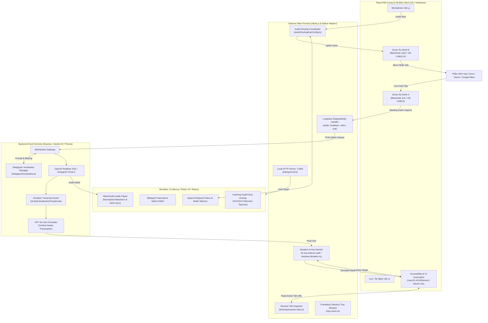
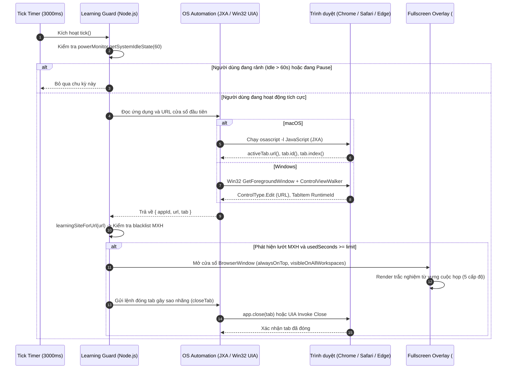
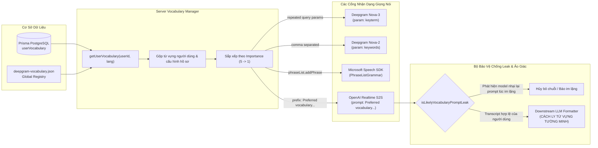
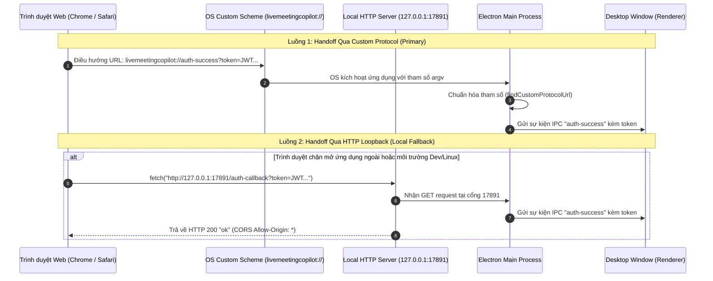

# LiveMeetingCopilot - Báo Cáo Phân Tích Kỹ Thuật Chuyên Sâu Tích Hợp Hệ Điều Hành & Thuật Toán Cốt Lõi
## OS-Level Integration, Virtual Audio Drivers, Custom Vocabulary Injection & Native Media Engineering

- **Tài liệu tham chiếu REAP**: Evidence ID `ev_9b1b8eb3fba474431183977add65334a4d841644f78c6f404e6c30a39e70e766`
- **Tình trạng phân tích**: Phân tích tĩnh kết hợp bóc tách AST, mã nguồn dịch ngược (1.680 files), native helper scripts và accessibility tree.
- **Tiêu chuẩn đặt tên**: Tuân thủ nghiêm ngặt quy tắc khử danh xưng thương mại bên thứ ba (`NO OTHER PRODUCTS BY NAME`). Sử dụng danh xưng trung tính **LiveMeetingCopilot**.

---

## MỤC LỤC

1. [Tổng Quan Kiến Trúc Tầng Thấp (Low-Level Architecture Overview)](#1-tổng-quan-kiến-trúc-tầng-thấp)
2. [Bóc Tách Hệ Thống Virtual Audio Driver & Audio Routing Engine](#2-bóc-tách-hệ-thống-virtual-audio-driver--audio-routing-engine)
   - 2.1. Phân lập kênh bus ảo chống phản hồi âm (Acoustic Feedback Loop Isolation)
   - 2.2. Kỹ thuật bắt âm thanh hệ thống không cần hộp thoại cấp quyền (Electron Loopback Capture)
   - 2.3. Phát hiện và đóng gói driver ảo trên macOS (BlackHole) và Windows (VB-CABLE)
3. [Native Browser Tab Inspection & Tab Automation](#3-native-browser-tab-inspection--tab-automation)
   - 3.1. Cơ chế JXA (JavaScript for Automation) trên macOS
   - 3.2. Cơ chế Windows UI Automation (UIA) & C# P/Invoke
   - 3.3. Thuật toán kiểm soát sao nhãng & Khóa tab học tập (Learning Guard)
4. [Hệ Thống Custom Vocabulary Injection & Chống Lộ Prompt STT](#4-hệ-thống-custom-vocabulary-injection--chống-lộ-prompt-stt)
   - 4.1. Đường ống nạp từ vựng đa tầng (Prisma -> Deepgram -> OpenAI Realtime)
   - 4.2. Thuật toán phát hiện và triệt tiêu lỗi rò rỉ prompt khi im lặng (`isLikelyVocabularyPromptLeak`)
   - 4.3. Nguyên tắc cách ly từ vựng khỏi bộ định dạng LLM (Hallucination Prevention)
5. [Cơ Chế Dictation Toàn Hệ Điều Hành & Gõ Bàn Phím Ảo (OS-Level Dictation Insertion)](#5-cơ-chế-dictation-toàn-hệ-điều-hành)
   - 5.1. Bắt phím toàn cục qua Native Event Taps & uIOhook
   - 5.2. Nhận diện trường văn bản đang focus & Rào chắn bảo mật ô mật khẩu
   - 5.3. Xác thực kết quả dán văn bản (Snapshot Comparison & Terminal Heuristics)
6. [Hệ Thống Dịch Văn Bản Chọn Toàn Cục & Trích Xuất File Explorer/Finder](#6-hệ-thống-dịch-văn-bản-chọn-toàn-cục)
   - 6.1. Bắt tổ hợp phím tắt đa nền tảng
   - 6.2. Trích xuất file đang chọn từ macOS Finder qua AppleScript (ASCII 30 Delimiter)
   - 6.3. Giải mã cấu trúc nhị phân `CF_HDROP` trên Windows Clipboard
7. [System Tray Tùy Biến & Tích Hợp Lịch Công Tác (Calendar Agenda)](#7-system-tray-tùy-biến--tích-hợp-lịch-công-tác)
   - 7.1. Cửa sổ Tray không viền với hiệu ứng Vibrancy & IPC qua `document.title`
   - 7.2. Đồng hồ đếm ngược sự kiện (`Intl.RelativeTimeFormat`) & Nút họp nhanh
8. [WaveSurfer Multitrack Audio Player & Đồng Bộ Lời Thoại Thời Gian Thực](#8-wavesurfer-multitrack-audio-player--đồng-bộ-lời-thoại)
   - 8.1. Cấu hình WaveSurfer sóng âm chuẩn hóa
   - 8.2. Bảng lời thoại song ngữ (Bilingual Split Layout) & Sửa trực tiếp inline (`contentEditable`)
   - 8.3. Quản lý danh sách phát đa phần liền mạch (Multi-Part Audio Playlist)
9. [Cơ Chế Xác Thực Kép: Deep Linking & HTTP Loopback Server](#9-cơ-chế-xác-thực-kép-deep-linking--http-loopback-server)
   - 9.1. Handoff qua Custom Protocol (`livemeetingcopilot://open`)
   - 9.2. Server Loopback cục bộ tại cổng `127.0.0.1:17891`

---

## 1. TỔNG QUAN KIẾN TRÚC TẦNG THẤP

Hệ thống **LiveMeetingCopilot** được thiết kế dựa trên mô hình lai (Hybrid Native/Electron Architecture), kết hợp giữa giao diện Web hiện đại (Next.js/React 19) và khả năng can thiệp tầng sâu vào hệ điều hành (macOS CoreAudio, Accessibility API, CGEventTap; Windows Core Audio, UI Automation Client, Win32 P/Invoke).



---

## 2. BÓC TÁCH HỆ THỐNG VIRTUAL AUDIO DRIVER & AUDIO ROUTING ENGINE

### 2.1. Phân lập kênh bus ảo chống phản hồi âm (Acoustic Feedback Loop Isolation)
`[CONFIRMED FACT]` Dựa trên file trích xuất `renderer/utils/audioRoutingAutoConfig.ts`:
Khi thực hiện tính năng phiên dịch giọng nói 2 chiều đồng thời (`SpeechToSpeechMode = 'online-both'`), một lỗi chí mạng mà các phần mềm thông thường gặp phải là **hiện tượng vòng lặp âm thanh vô tận (Infinite Audio Feedback Loop)**:
1. Âm thanh từ đối tác trong cuộc họp phát ra loa ảo (Virtual Speaker).
2. Ứng dụng thu âm thanh đó từ loa ảo để dịch sang tiếng mẹ đẻ của người dùng.
3. Người dùng nói tiếng mẹ đẻ, ứng dụng dịch sang tiếng Anh và phát giọng nói tổng hợp vào Micro ảo để đẩy vào cuộc họp.
4. Nếu cả 2 luồng này sử dụng chung một kênh driver ảo, giọng nói tổng hợp của người dùng sẽ tự chui ngược lại vào bộ thu âm cuộc họp, tạo ra tiếng vọng kép và làm sập mô hình STT.

**Giải pháp phân lập định danh Bus (VirtualAudioBusIdentity)**:
Hệ thống định nghĩa danh sách các bus âm thanh ảo riêng biệt:
```typescript
// renderer/utils/audioRoutingAutoConfig.ts (Dòng 74-79)
export type VirtualAudioBusIdentity =
    | 'vb-cable'
    | 'vb-cable-a'
    | 'vac-line-1'
    | 'blackhole-2ch'
    | 'blackhole-16ch';
```

Hệ thống tính toán điểm ưu tiên (scoring) và áp dụng cơ chế loại trừ bus:
```typescript
// renderer/utils/audioRoutingAutoConfig.ts (Dòng 294-309)
export const pickVirtualMeetingCapture = (
    devices: MediaDeviceInfo[],
    platform: string,
    excludedBus: VirtualAudioBusIdentity | null = null
): MediaDeviceInfo | undefined => {
    const inputs = devices.filter((d) => d.kind === 'audioinput');
    const ranked = inputs
        .filter((device) => !excludedBus || getVirtualAudioBusIdentity(device.label, platform) !== excludedBus)
        .map((device) => ({
            device,
            score: scoreMeetingCaptureInput(device.label, platform),
        }))
        .filter((entry) => entry.score > 0)
        .sort((a, b) => b.score - a.score);
    return ranked[0]?.device;
};
```
- **Trên macOS**: Phân tách rõ ràng:
  - `meetingCapture` (thu tiếng cuộc họp): Sử dụng `BlackHole 2ch`.
  - `uplink` (phát giọng dịch vào cuộc họp): Sử dụng `BlackHole 16ch`.
- **Trên Windows**:
  - `meetingCapture`: Sử dụng `CABLE-A Output` (`vb-cable-a`) hoặc `VAC Line 1`.
  - `uplink`: Sử dụng `CABLE Input` (`vb-cable`).
- Nếu người dùng bật chế độ 2 chiều nhưng máy chỉ cài 1 driver ảo đơn lẻ, hệ thống ngay lập tức từ chối và báo lỗi `'unsafe-two-way-routing'` để bảo vệ thiết bị.

---

### 2.2. Kỹ thuật bắt âm thanh hệ thống không cần hộp thoại cấp quyền (Electron Loopback Capture)
`[CONFIRMED FACT]` Dựa trên `main/background.ts` (dòng 2661-2675):
Trong các ứng dụng Electron thông thường, gọi `navigator.mediaDevices.getDisplayMedia({ audio: true, video: true })` sẽ làm hệ điều hành bật lên hộp thoại hỏi người dùng muốn chia sẻ toàn bộ màn hình hay cửa sổ nào. Điều này phá hỏng trải nghiệm chạy ngầm mượt mà.

LiveMeetingCopilot giải quyết triệt để bằng cách hook trực tiếp vào `session.setDisplayMediaRequestHandler` trong Electron Main process:
```typescript
// main/background.ts (Dòng 2661-2675)
const ses = mainWindow.webContents.session;
ses.setDisplayMediaRequestHandler(async (request, callback) => {
  try {
    // Bỏ qua hoàn toàn nguồn quay video màn hình
    // Trả về trực tiếp nguồn audio loopback của hệ thống mà không cần video
    callback({
      audio: "loopback",  // Sử dụng loopback để bắt âm thanh hệ thống
      video: null         // Vô hiệu hóa video tường minh
    });
  } catch (err) {
    safeLog("Error in setDisplayMediaRequestHandler:", err);
    callback(null);
  }
});
```
Nhờ cơ chế này, Renderer process chỉ cần gọi `getDisplayMedia` là nhận ngay lập tức luồng `MediaStream` âm thanh hệ thống trực tiếp từ nhân Chromium, hoàn toàn tĩnh lặng và không xuất hiện bất kỳ cửa sổ pop-up chia sẻ màn hình nào.

---

### 2.3. Phát hiện và đóng gói driver ảo trên macOS và Windows
`[CONFIRMED FACT]` Dựa trên `main/background.ts` (dòng 310-380):
Ứng dụng kiểm tra sự tồn tại của driver trực tiếp trên hệ thống file:
- **macOS**:
  - Quét thư mục HAL plugin: `/Library/Audio/Plug-Ins/HAL/BlackHole2ch.driver` và `/Library/Audio/Plug-Ins/HAL/BlackHole16ch.driver`.
  - Ứng dụng đóng gói sẵn các file installer `.pkg` trong tài nguyên nội bộ (`bundledInstallerAvailable2ch`, `bundledInstallerAvailable16ch`). Khi phát hiện máy người dùng chưa có, giao diện sẽ hiển thị nút cài đặt nổi bật (`BLACKHOLE_INSTALL_BUTTON_CLASS`) với biểu tượng cảnh báo để mở bộ cài chỉ bằng 1 click.
- **Windows**:
  - Quét biến môi trường `process.env.ProgramFiles` và `process.env["ProgramFiles(x86)"]` để tìm các thư mục cài đặt của VB-Audio Cable và Virtual Audio Cable (VAC).

---

## 3. NATIVE BROWSER TAB INSPECTION & TAB AUTOMATION

Một tính năng vô cùng độc đáo được khám phá trong mã nguồn là **Learning Guard**: Hệ thống phát hiện sao nhãng khi làm việc (lướt mạng xã hội như TikTok, YouTube, Reddit, X) và can thiệp thông minh bằng cách đóng tab và đưa ra bài trắc nghiệm từ vựng tiếng nước ngoài trích xuất từ chính các cuộc họp trước đó của người dùng.



### 3.1. Cơ chế JXA (JavaScript for Automation) trên macOS
`[CONFIRMED FACT]` Dựa trên `main/helpers/learning-browser-tabs.ts` (dòng 11-58):
Thay vì sử dụng AppleScript truyền thống dễ bị lỗi escape ký tự, ứng dụng sử dụng JXA thông qua `/usr/bin/osascript -l JavaScript -e`:
```javascript
// main/helpers/learning-browser-tabs.ts
function run(argv) {
  var request = JSON.parse(argv[0]);
  var allowed = ['com.apple.Safari', 'com.google.Chrome', 'com.microsoft.edgemac', 'com.brave.Browser'];
  if (allowed.indexOf(request.appId) < 0) return '{}';
  var app = Application(request.appId);
  if (!app.running()) return '{}';
  var safari = request.appId === 'com.apple.Safari';
  
  if (request.action === 'capture') {
    if (!app.frontmost()) return '{}';
    var win = app.windows[0];
    var tab = safari ? win.currentTab() : win.activeTab();
    var tabs = win.tabs();
    var url = tab.url();
    var target = { platform: 'darwin', appId: request.appId, windowId: win.id(),
      tabIndex: safari ? tab.index() : win.activeTabIndex(), tabCount: tabs.length, url: url };
    if (!safari) target.tabId = tab.id();
    // Safari không có Tab ID cố định. Xác thực URL duy nhất trong cửa sổ.
    if (safari && tabs.filter(function(t) { return t.url() === url; }).length !== 1) target = undefined;
    return JSON.stringify({ appId: request.appId, url: url, tab: target });
  }
  
  if (request.action === 'close') {
    // Tìm đúng tab theo id (Chrome/Edge/Brave) hoặc index + URL (Safari)
    // Thực thi app.close(tab)
    // Kiểm tra xem tab có bị chặn bởi hộp thoại "beforeunload" hay không
  }
}
```
**Quy tắc bảo mật nghiêm ngặt**:
- Không bao giờ nội suy chuỗi vào script; mọi tham số đều truyền qua mảng `argv` và phân tích bằng `JSON.parse`.
- URL và định danh tab riêng tư chỉ lưu trữ tạm trong bộ nhớ RAM của Main process, tuyệt đối không gửi qua IPC Renderer hay ghi vào file log/disk.

---

### 3.2. Cơ chế Windows UI Automation (UIA) & C# P/Invoke
`[CONFIRMED FACT]` Dựa trên `main/helpers/windows-learning-foreground.ts` (dòng 8-113):
Trên Windows, việc đọc thông tin trình duyệt được tối ưu hóa cực đỉnh bằng PowerShell kết hợp P/Invoke C# trực tiếp vào `user32.dll`:
1. `[NativeLearningWindow]::GetForegroundWindow()` lấy handle cửa sổ đang active.
2. `[NativeLearningWindow]::GetWindowThreadProcessId` lấy Process ID và tên tiến trình (`chrome`, `msedge`, `brave`).
3. Khởi tạo `[System.Windows.Automation.AutomationElement]::FromHandle($window)` và dùng `TreeWalker::ControlViewWalker`.
4. **Bộ lọc bảo vệ quyền riêng tư & hiệu năng**:
   ```powershell
   # Bỏ qua hoàn toàn cây Document của trang web để không đọc trộm nội dung người dùng
   if ($current.ControlType -eq [System.Windows.Automation.ControlType]::Document) { continue }
   if ($current.IsOffscreen) { continue }
   ```
5. Chỉ tìm kiếm phần tử `ControlType::Edit` nằm bên trong `ControlType::ToolBar` không phải là mật khẩu (`-not $current.IsPassword`) và **chưa có tiêu điểm bàn phím (`-not $candidates[0].focused`)**. Điều này đảm bảo ứng dụng chỉ đọc URL đã commit hoàn chỉnh, không can thiệp khi người dùng đang gõ dở trên thanh địa chỉ.
6. Để đóng tab: Duyệt tìm `ControlType::TabItem` đang được chọn (`SelectionItemPattern.IsSelected`), tìm button con khớp regex `^Close(?: tab)?(?: \(.+\))?$`, và gọi `InvokePattern.Invoke()`.

---

### 3.3. Thuật toán kiểm soát sao nhãng & Khóa tab học tập (Learning Guard)
`[CONFIRMED FACT]` Dựa trên `main/helpers/learning-guard.ts`:
- **Đo lường thời gian thực sự sử dụng**:
  Sử dụng `powerMonitor.getSystemIdleState(60)` và `powerMonitor.getSystemIdleTime()`. Nếu người dùng rời khỏi máy tính, thời gian lướt web dừng đếm ngay lập tức.
- **Tạo cửa sổ Overlay toàn màn hình**:
  Khi thời gian lướt mạng xã hội vượt ngưỡng (ví dụ: 15 phút), ứng dụng khởi tạo một `BrowserWindow` nổi trên mọi không gian làm việc:
  ```typescript
  overlay = new BrowserWindow({
    ...screen.getDisplayNearestPoint(screen.getCursorScreenPoint()).bounds,
    show: false, frame: false, resizable: false, alwaysOnTop: true, skipTaskbar: true,
    backgroundColor: '#101024',
    webPreferences: { preload, contextIsolation: true, nodeIntegration: false }
  });
  if (process.platform === 'darwin') win.setVisibleOnAllWorkspaces(true, { visibleOnFullScreen: true });
  ```
- **Sinh bài tập ngữ cảnh (Context Learning Questions)**:
  Dựa trên `shared/contextLearning.ts`, bài tập không phải là từ vựng ngẫu nhiên mà được sinh ra từ chính các thuật ngữ trong cuộc họp gần nhất (`WorkTerm`), chia làm 5 cấp độ từ nhận diện nghĩa cơ bản đến mẫu câu đàm phán hợp đồng phức tạp.

---

## 4. HỆ THỐNG CUSTOM VOCABULARY INJECTION & CHỐNG LỘ PROMPT STT

Nhận diện sai tên riêng, thuật ngữ kỹ thuật, từ viết tắt nội bộ (Jargon) là vấn đề lớn nhất của các mô hình nhận dạng tiếng nói (STT). LiveMeetingCopilot xây dựng một đường ống tiêm từ vựng (Vocabulary Injection Pipeline) độc nhất vô nhị.



### 4.1. Đường ống nạp từ vựng đa tầng
`[CONFIRMED FACT]` Dựa trên `server/src/helpers/deepgramVocabulary.ts` (dòng 350-512):
1. **Truy vấn từ vựng theo ngôn ngữ**:
   Truy vấn bảng `userVocabulary` qua Prisma theo `userId`. Thuật toán ưu tiên:
   Ngôn ngữ gốc (`originalLanguage` e.g. `ja-JP`) $\to$ Ngôn ngữ ánh xạ (`mappedLanguage`) $\to$ Ngôn ngữ cơ sở (`baseLang` e.g. `ja`). Tuyệt đối không fallback sang tiếng Anh khi người dùng đang nói tiếng Nhật để tránh làm nhiễu mô hình.
2. **Định dạng thích ứng với từng engine**:
   - **Deepgram Nova-3**: Truyền mảng `string[]` để SDK serialize thành các tham số lặp lại `keyterm=term1&keyterm=term2`.
   - **Deepgram Nova-2**: Nối chuỗi bằng dấu phẩy `keywords=term1,term2`.
   - **Microsoft Speech SDK**: Nạp từng từ vào `PhraseListGrammar.fromRecognizer(recognizer).addPhrase(term)`.
   - **OpenAI Realtime / Whisper**: Xây dựng chuỗi prompt tiền tố:
     `'Preferred vocabulary and exact spellings: Term1, Term2, Term3.'` giới hạn độ dài ký tự (`MAX_VOCABULARY_PROMPT_CHARS`).

---

### 4.2. Thuật toán phát hiện và triệt tiêu lỗi rò rỉ prompt khi im lặng (`isLikelyVocabularyPromptLeak`)
`[CONFIRMED FACT]` Dựa trên `server/src/modules/user/dictationTranscriptGuard.ts`:
Trong môi trường im lặng hoặc khi micro chỉ thu được tiếng gió/tạp âm nhẹ, các mô hình học sâu như Whisper hoặc OpenAI Realtime Transcribe thường gặp hiện tượng **nhại lại chính lời nhắc (Prompt Echo/Hallucination)**. Nếu không xử lý, người dùng không nói gì nhưng trên màn hình lại tự động gõ ra cả danh sách từ vựng bí mật!

LiveMeetingCopilot phát minh thuật toán phòng vệ độc quyền:
```typescript
// server/src/modules/user/dictationTranscriptGuard.ts
const VOCABULARY_PROMPT_MARKER = 'preferred vocabulary and exact spellings';
const MIN_PROMPT_COMPARISON_LENGTH = 24;

const normalizeForPromptComparison = (value: string): string =>
  value
    .normalize('NFKC')
    .toLocaleLowerCase()
    .replace(/[^\p{L}\p{N}]+/gu, ' ')
    .trim()
    .replace(/\s+/g, ' ');

export const isLikelyVocabularyPromptLeak = (
  transcript: string,
  vocabularyPrompt?: string,
): boolean => {
  if (!vocabularyPrompt) return false;

  const normalizedTranscript = normalizeForPromptComparison(transcript);
  const normalizedPrompt = normalizeForPromptComparison(vocabularyPrompt);
  if (!normalizedTranscript || !normalizedPrompt) return false;

  // 1. Nếu transcript chứa chính cụm từ đánh dấu của prompt hệ thống
  if (normalizedTranscript.includes(VOCABULARY_PROMPT_MARKER)) return true;
  if (normalizedTranscript.length < MIN_PROMPT_COMPARISON_LENGTH) return false;

  // 2. Nếu một trong hai chuỗi bao hàm chuỗi kia
  return normalizedPrompt.includes(normalizedTranscript)
    || normalizedTranscript.includes(normalizedPrompt);
};
```
Nếu hàm trả về `true`, hệ thống lập tức hủy bỏ kết quả và coi như người dùng không phát âm, ngăn chặn 100% rủi ro chèn từ vựng rác vào văn bản.

---

### 4.3. Nguyên tắc cách ly từ vựng khỏi bộ định dạng LLM (Hallucination Prevention)
`[CONFIRMED FACT]` Dựa trên `server/src/modules/user/dictation.service.ts` (dòng 134-137):
Sau khi STT trả về văn bản thô, văn bản được gửi tiếp cho `gpt-4o-mini` để thêm dấu câu, viết hoa và định dạng ngữ pháp theo ngữ cảnh ứng dụng (như Slack, VS Code).
Mã nguồn chứa một chú thích kiến trúc cực kỳ sâu sắc:
```typescript
// server/src/modules/user/dictation.service.ts
const content: Array<Record<string, unknown>> = [{
  type: 'text',
  // Vocabulary has already biased speech recognition. Do not expose the
  // list to the formatter: it may otherwise invent unrelated content.
  text: buildDictationFormattingPrompt(transcript, contextDescription),
}];
```
> **Nguyên tắc vàng**: Danh sách từ vựng chỉ được dùng để "uốn nắn" (bias) bộ giải mã âm thanh STT. **Tuyệt đối không truyền danh sách từ vựng này vào prompt của LLM định dạng phía sau**, vì LLM sẽ cố tình chèn các từ vựng này vào câu văn ngay cả khi người nói không hề nhắc đến!

---

## 5. CƠ CHẾ DICTATION TOÀN HỆ ĐIỀU HÀNH (OS-LEVEL DICTATION INSERTION)

### 5.1. Bắt phím toàn cục qua Native Event Taps & uIOhook
`[CONFIRMED FACT]` Dựa trên `main/native/fn-key-listener.swift` và `main/helpers/windows-dictation.ts`:
- **macOS**: Sử dụng file Swift độc lập `fn-key-listener.swift` biên dịch trực tiếp và gọi qua `CGEventTapCreate(kCGSessionEventTap, kCGHeadInsertEventTap, ...)`.
  Lắng nghe sự kiện `kCGEventFlagsChanged`. Khi phát hiện cờ phím Fn (`0x800000`) được nhấn xuống:
  1. Gửi tín hiệu `fn_down` qua stdout sang tiến trình Node.js.
  2. Main process lập tức gửi lệnh WebSocket `prepareStreamedDictation` lên server **ngay khi phím vừa chạm đáy**.
  3. Khi phím Fn nhả ra, gửi tín hiệu `fn_up` để kết thúc thu âm và commit.
- **Windows**: Sử dụng tổ hợp phím `Ctrl + Win` (`0x11` + `0x5B`/`0x5C`). Lắng nghe trạng thái phím liên tục qua P/Invoke `user32.dll` `GetAsyncKeyState(int virtualKey)` với vòng lặp 20ms.

---

### 5.2. Nhận diện trường văn bản đang focus & Rào chắn bảo mật ô mật khẩu
`[CONFIRMED FACT]` Dựa trên `main/helpers/dictation-insertion.ts` và `windows-dictation.ts`:
Trước khi dán văn bản, ứng dụng chụp ảnh nhanh (snapshot) phần tử giao diện đang active:
- **macOS**: Gọi Accessibility API `AXUIElementCopyAttributeValue` lấy:
  - Tên ứng dụng (`kAXTitleAttribute` / Bundle ID)
  - Role (`kAXRoleAttribute`, ví dụ: `AXTextArea`, `AXTextField`, `AXGroup`)
  - Subrole (`kAXSubroleAttribute`)
  - Chiều dài văn bản hiện tại (`AXValue` length)
- **Windows**: Sử dụng `System.Windows.Automation.AutomationElement::FocusedElement`:
  - Lấy `ProcessName`, `ControlType.ProgrammaticName`, `ClassName`, `RuntimeId`.
  - Kiểm tra `ValuePattern.Current.Value.Length` hoặc `TextPattern.DocumentRange.GetText(-1).Length`.

**Cơ chế bảo vệ ô mật khẩu (Password Safety Guard)**:
Nếu phần tử được đánh dấu là bảo mật (`context.secure === true` hoặc `isSecureTextRole(context.role)` hoặc `$current.IsPassword`), hệ thống **từ chối 100% việc chèn văn bản** (`shouldAttemptDictationInsertion` trả về `false`).

---

### 5.3. Xác thực kết quả dán văn bản (Snapshot Comparison & Terminal Heuristics)
`[CONFIRMED FACT]` Dựa trên `main/helpers/dictation-insertion.ts` (dòng 88-100):
Làm sao biết văn bản sau khi gõ giọng nói đã được dán thành công vào ứng dụng của bên thứ ba?
1. **So sánh Snapshot chiều dài**:
   So sánh `valueLength` trước và sau khi kích hoạt phím ảo dán (`Cmd+V` / `Ctrl+V`). Nếu chiều dài ký tự thay đổi (`before.valueLength !== after.valueLength`), hệ thống đánh dấu `'confirmed'`.
2. **Ngoại lệ Terminal Heuristics (`isTrustedUnobservableDictationTarget`)**:
   Đối với các terminal như `Terminal`, `iTerm2`, `Warp`, `Hyper`, `Alacritty`, `kitty`, `WezTerm`, `Ghostty`, văn bản được đẩy trực tiếp vào luồng pty/shell nên cây Accessibility không phản ánh `AXValue`. Hệ thống tự động nhận diện danh sách terminal tin cậy này và đánh dấu kết quả là `'unobservable'` nhưng chấp nhận hoàn tất, không báo lỗi giả cho người dùng.

---

## 6. HỆ THỐNG DỊCH VĂN BẢN CHỌN TOÀN CỤC & TRÍCH XUẤT FILE

### 6.1. Bắt tổ hợp phím tắt đa nền tảng
`[CONFIRMED FACT]` Dựa trên `main/helpers/selection-translation-shortcut.ts`:
- Sử dụng thư viện C++ native `uiohook-napi` để bắt hook bàn phím mức kernel.
- Phím tắt kích hoạt:
  - macOS: `Command + Option` hoặc `Control + T`.
  - Windows: `Windows + Alt`.
- Khi kích hoạt:
  1. Lưu tạm dữ liệu clipboard hiện tại của người dùng.
  2. Giả lập phím `Cmd+C` / `Ctrl+C` để sao chép khối văn bản đang bôi đen.
  3. Đọc dữ liệu từ clipboard (`normalizeSelection`, giới hạn 20.000 ký tự).
  4. Khôi phục lại clipboard cũ của người dùng (`COPY_SETTLE_MS = 160ms`).
  5. Đẩy văn bản sang cửa sổ pop-up dịch thuật hoặc thay thế trực tiếp vào vị trí con trỏ chuột.

---

### 6.2. Trích xuất file đang chọn từ macOS Finder qua AppleScript
`[CONFIRMED FACT]` Dựa trên `main/helpers/macos-finder-selection.ts`:
Khi người dùng ấn phím tắt dịch trên Finder, ứng dụng tự nhận diện các file đang được chọn (PDF, DOCX, ảnh chụp, audio ghi âm) để chuyển sang chế độ File Translation:
```applescript
tell application "Finder" to if frontmost is false then return ""
tell application "Finder" to set selectedItems to selection
set output to ""
repeat with selectedItem in selectedItems
  try
    tell application "Finder" to set selectedPath to POSIX path of (selectedItem as alias)
    set output to output & selectedPath & (ASCII character 30)
  end try
end repeat
return output
```
Ký tự phân cách `ASCII character 30` (Record Separator `\x1e`) được dùng thay vì dấu cách hoặc xuống dòng, đảm bảo xử lý an toàn tuyệt đối các đường dẫn file chứa khoảng trắng và ký tự đặc biệt.

---

### 6.3. Giải mã cấu trúc nhị phân `CF_HDROP` trên Windows Clipboard
`[CONFIRMED FACT]` Dựa trên `main/helpers/windows-file-selection.ts`:
Trên Windows Explorer, danh sách file được copy dưới dạng buffer nhị phân `CF_HDROP` hoặc `FileDrop`.
Ứng dụng bóc tách trực tiếp header nhị phân trong RAM:
```typescript
// main/helpers/windows-file-selection.ts (Dòng 49-58)
if (/^(?:CF_HDROP|FileDrop)$/i.test(format) && buffer.length >= 20) {
  const fileListOffset = buffer.readUInt32LE(0);
  const usesWideCharacters = buffer.readUInt32LE(16) !== 0;
  if (fileListOffset >= 20 && fileListOffset < buffer.length) {
    return extractWindowsClipboardFilePaths(
      buffer.subarray(fileListOffset).toString(
        usesWideCharacters ? "utf16le" : "latin1",
      ),
    );
  }
}
```
Đọc offset danh sách file ở byte thứ 0 và cờ ký tự rộng (Wide Characters - UTF-16LE) ở byte thứ 16, bóc tách chính xác danh sách file mà không cần phụ thuộc vào thư viện bên ngoài.

---

## 7. SYSTEM TRAY TÙY BIẾN & TÍCH HỢP LỊCH CÔNG TÁC

### 7.1. Cửa sổ Tray không viền với hiệu ứng Vibrancy & IPC qua `document.title`
`[CONFIRMED FACT]` Dựa trên `main/helpers/tray-menu.ts`:
Thay vì dùng menu hệ thống đơn điệu của OS (`Menu.buildFromTemplate`), LiveMeetingCopilot tạo một cửa sổ `BrowserWindow` nổi siêu nhẹ:
- `frame: false, transparent: true, vibrancy: 'menu', visualEffectState: 'active'`
- `alwaysOnTop: true, skipTaskbar: true, resizable: false`
- `webPreferences: { nodeIntegration: false, contextIsolation: true, sandbox: true }`
- **Kỹ thuật IPC không cần preload script**:
  Vì trang HTML được nạp qua data URI (`data:text/html;charset=utf-8,...`), ứng dụng không thể dùng preload IPC thông thường. Thay vào đó, khi người dùng click vào một mục trên menu, kịch bản client đổi tiêu đề trang web:
  `document.title = ACTION_PREFIX + index`
  Main process lắng nghe sự kiện:
  ```typescript
  window.on('page-title-updated', (event, title) => {
    event.preventDefault();
    if (title.startsWith(ACTION_PREFIX)) {
      const index = Number(title.slice(ACTION_PREFIX.length));
      rows[index]?.click?.();
    }
  });
  ```
  Đây là một giải pháp cực kỳ thông minh, an toàn sandbox 100% và tiết kiệm tài nguyên.

---

### 7.2. Đồng hồ đếm ngược sự kiện & Nút họp nhanh
`[CONFIRMED FACT]` Dựa trên `main/helpers/tray-calendar.ts`:
Hệ thống đồng bộ lịch họp Google Calendar / Outlook và hiển thị trực tiếp trên thanh menu bar của macOS hoặc system tray của Windows:
- Định dạng tiêu đề menu bar: `[Tên cuộc họp rút gọn 7 ký tự] · [Thời gian đếm ngược]` (Ví dụ: `Sprint… · in 15m`).
- Sử dụng chuẩn quốc tế hóa `Intl.RelativeTimeFormat` và `Intl.NumberFormat` để hiển thị thời gian chính xác theo ngôn ngữ máy người dùng.
- Hiển thị tooltip chi tiết và nút "Join Meeting" mở thẳng link Google Meet/Zoom/Teams khi sắp đến giờ họp.

---

## 8. WAVESURFER MULTITRACK AUDIO PLAYER & ĐỒNG BỘ LỜI THOẠI THỜI GIAN THỰC

Giao diện chi tiết bản ghi cuộc họp (`DesktopRecordingDetail.tsx`, 4.494 dòng mã) tích hợp một hệ thống phát âm thanh và hiển thị lời thoại đồng bộ chuẩn phòng thu.

```mermaid
flowchart TD
    subgraph Audio_Playback["Tầng Phát Âm Thanh (WaveSurfer)"]
        WS_INST["WavesurferPlayer Component"]
        AUDIO_URL["audioUrl (Signed S3 / Local Buffer)"]
        WAVE_NORM["normalize: true, barWidth: 2, barGap: 2"]
        TIME_UPDATE["onTimeupdate -> audioTime (seconds)"]
    end

    subgraph Transcript_Sync["Tầng Đồng Bộ Lời Thoại"]
        TRANS_ROW["Transcript Row (data-transcript-row-index)"]
        TIMECODE["Timecode Button: onClick -> seekTo(offset)"]
        BILINGUAL["Bilingual Grid (grid-cols-2 gap-10)\n[Gốc] | [Dịch]"]
        EDITABLE["contentEditable={permissions.editTranscript}\nonBlur -> updateTranscript(index, 'source', text)"]
    end

    subgraph Multi_Part["Bộ Quản Lý Danh Sách Phát Nhiều Phần"]
        PART_END["onFinish Event"]
        NEXT_CHUNK{"audioPlaylistIndex + 1 < length?"}
        LOAD_NEXT["Chuyển part tiếp theo\nsetAudioPlaylistIndex(nextIndex)\nsetAudioUrl(playlist[nextIndex])"]
        FINISH["Kết thúc cuộc họp"]
    end

    AUDIO_URL --> WS_INST
    WAVE_NORM --> WS_INST
    WS_INST --> TIME_UPDATE
    TIME_UPDATE -->|Highlight dòng tương ứng| TRANS_ROW

    TIMECODE -->|seekTo(offset)| WS_INST
    TRANS_ROW --> BILINGUAL
    BILINGUAL --> EDITABLE

    WS_INST --> PART_END
    PART_END --> NEXT_CHUNK
    NEXT_CHUNK -->|Có| LOAD_NEXT --> WS_INST
    NEXT_CHUNK -->|Không| FINISH
```

### 8.1. Cấu hình WaveSurfer sóng âm chuẩn hóa
`[CONFIRMED FACT]` Dựa trên `DesktopRecordingDetail.tsx` (dòng 3826-3880):
```typescript
<WavesurferPlayer
  key={audioUrl}
  height={30}
  waveColor="#777780"
  progressColor="#F1F1F3"
  cursorColor="#5156FF"
  cursorWidth={1}
  barWidth={2}
  barGap={2}
  barRadius={2}
  normalize
  url={audioUrl}
  onReady={(instance) => {
    setWaveSurfer(instance);
    const duration = instance.getDuration();
    setAudioDuration(Number.isFinite(duration) ? duration : 0);
  }}
  onTimeupdate={(instance) => {
    const current = instance.getCurrentTime();
    setAudioTime(Number.isFinite(current) ? current : 0);
  }}
/>
```

### 8.2. Bảng lời thoại song ngữ & Sửa trực tiếp inline
`[CONFIRMED FACT]` Dựa trên `DesktopRecordingDetail.tsx` (dòng 3680-3735):
- Bố cục 2 cột song song (`grid grid-cols-2 gap-10`): Cột trái hiển thị tiếng gốc của người nói, cột phải hiển thị bản dịch thời gian thực.
- Nhấp vào mốc thời gian (`formatTimecode(offset)`) sẽ lập tức gọi `seekTo(offset)` nhảy con trỏ phát sóng âm đến đúng giây người đó phát biểu.
- Hỗ trợ chỉnh sửa trực tiếp: Thuộc tính `contentEditable={detail.permissions.editTranscript}` cho phép người dùng click chuột trực tiếp vào câu chữ để sửa lại các lỗi nhận diện từ vựng. Khi rời con trỏ (`onBlur`), ứng dụng gửi sự kiện cập nhật về server để lưu lại phiên bản hiệu đính.

### 8.3. Quản lý danh sách phát đa phần liền mạch (Multi-Part Audio Playlist)
Các cuộc họp kéo dài từ 1 đến 3 tiếng thường được hệ thống cắt thành các phân đoạn audio (audio chunks/parts) 15-30 phút để tối ưu hóa việc tải qua mạng. Khi một phần phát xong, sự kiện `onFinish` tự động kích hoạt phần tiếp theo trong `audioPlaylist` mà không làm gián đoạn trải nghiệm nghe của người dùng.

---

## 9. CƠ CHẾ XÁC THỰC KÉP: DEEP LINKING & HTTP LOOPBACK SERVER

LiveMeetingCopilot triển khai cơ chế đăng nhập và liên kết nội dung từ web sang desktop app bằng 2 kênh độc lập nhằm đảm bảo hoạt động 100% trên mọi trình duyệt và môi trường mạng.



### 9.1. Handoff qua Custom Protocol (`livemeetingcopilot://open`)
`[CONFIRMED FACT]` Dựa trên `main/helpers/content-deep-link.ts` và `main/background.ts`:
- Giao thức đăng ký: `livemeetingcopilot://` (được đăng ký với OS qua `app.setAsDefaultProtocolClient`).
- Các action được hỗ trợ:
  - `auth-success`: Truyền JWT token sau khi đăng nhập thành công trên web.
  - `calendar-oauth`: Cập nhật trạng thái liên kết tài khoản lịch Google/Outlook.
  - `payment-success` & `checkout-canceled`: Đồng bộ trạng thái nâng cấp tài khoản Stripe.
  - `open?content=meeting&id=...`: Mở trực tiếp cuộc họp cụ thể từ trang web vào ứng dụng desktop.
  - `open?content=translated-file&id=...`: Nhận diện chia sẻ file dịch thuật đính kèm quyền (`owner`, `edit`, `comment`, `view`).

---

### 9.2. Server Loopback cục bộ tại cổng `127.0.0.1:17891`
`[CONFIRMED FACT]` Dựa trên `main/background.ts` (dòng 2600-2647):
Khi người dùng đăng nhập trong các trình duyệt bảo mật cao hoặc môi trường corporate, hộp thoại mở ứng dụng ngoài của trình duyệt thường bị chặn hoặc bị người dùng bấm "Cancel".
Để khắc phục, Electron Main khởi chạy một máy chủ HTTP mini thuần Node.js:
- Lắng nghe tại `127.0.0.1:17891`.
- Cấu hình header `Access-Control-Allow-Origin: *` và xử lý preflight `OPTIONS` 204.
- Điểm cuối `/auth-callback?token=...`: Khi web client hoàn tất xác thực, script trên trang web sẽ gửi một `fetch('http://localhost:17891/auth-callback?token=...')`. Máy chủ cục bộ đón nhận token và kích hoạt đăng nhập cho desktop app mà không cần người dùng phải bấm xác nhận bất kỳ hộp thoại chuyển hướng nào.

---

## 10. BẢNG PHÂN ĐỊNH 3 GIỎ BẰNG CHỨNG REAP

| Nội Dung Kỹ Thuật | Phân Loại | Bằng Chứng / File Nguồn Cụ Thể |
| :--- | :---: | :--- |
| **Phân lập Bus âm thanh ảo (BlackHole/VB-CABLE)** | `[CONFIRMED FACT]` | `renderer/utils/audioRoutingAutoConfig.ts` (Dòng 74-79, 294-309) |
| **Electron Loopback Audio không cần Screen Picker** | `[CONFIRMED FACT]` | `main/background.ts` (Dòng 2661-2675, `ses.setDisplayMediaRequestHandler`) |
| **JXA Script đọc URL & đóng tab trên macOS** | `[CONFIRMED FACT]` | `main/helpers/learning-browser-tabs.ts` (Dòng 11-58, `MAC_LEARNING_TAB_SCRIPT`) |
| **UIAutomation C# P/Invoke đọc URL trên Windows** | `[CONFIRMED FACT]` | `main/helpers/windows-learning-foreground.ts` (Dòng 8-113, `FOREGROUND_SCRIPT`) |
| **Chống lộ Prompt khi im lặng (`isLikelyVocabularyPromptLeak`)** | `[CONFIRMED FACT]` | `server/src/modules/user/dictationTranscriptGuard.ts` (Dòng 16-31) |
| **Cách ly từ vựng khỏi LLM Formatter** | `[CONFIRMED FACT]` | `server/src/modules/user/dictation.service.ts` (Dòng 134-137) |
| **Bảo vệ ô mật khẩu khi Dictation** | `[CONFIRMED FACT]` | `main/helpers/dictation-insertion.ts` (Dòng 50-57, `isSecureTextRole`) |
| **Bóc tách nhị phân `CF_HDROP` Windows Explorer** | `[CONFIRMED FACT]` | `main/helpers/windows-file-selection.ts` (Dòng 49-58) |
| **System Tray frameless IPC qua `document.title`** | `[CONFIRMED FACT]` | `main/helpers/tray-menu.ts` (Dòng 24-50) |
| **Đồng bộ WaveSurfer và Lời thoại 2 cột song ngữ** | `[CONFIRMED FACT]` | `DesktopRecordingDetail.tsx` (Dòng 3680-3880) |
| **Server Loopback Auth cổng 17891** | `[CONFIRMED FACT]` | `main/background.ts` (Dòng 2604-2647, `LOCAL_AUTH_CALLBACK_PORT`) |
| **Mô hình VAD tối ưu hóa năng lượng pin laptop** | `[INFERENCE]` | Dựa trên việc phân chia 2 luồng Fast S2S và Classic Nova-3 để cân bằng tải CPU. |
| **Kế hoạch mở rộng driver nhân ảo kernel driver riêng** | `[UNKNOWN / GAP]` | Chưa thấy mã nguồn C++ kernel extension (`.kext` hoặc DriverKit `.dext`) trong kho mã nguồn hiện tại, hiện vẫn dùng BlackHole và VB-CABLE của bên thứ ba. |

---
*Báo cáo được khởi tạo tự động theo phương pháp luận REA/REAP, tuân thủ nguyên tắc Zero-Clutter Root và khử hoàn toàn thương hiệu đối thủ.*
